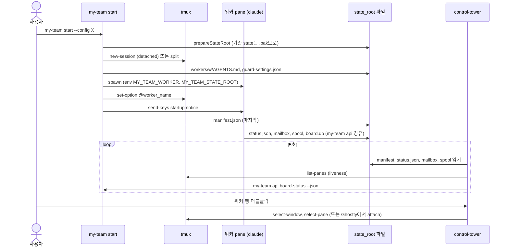
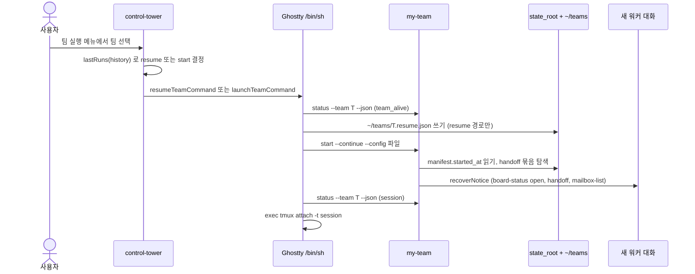
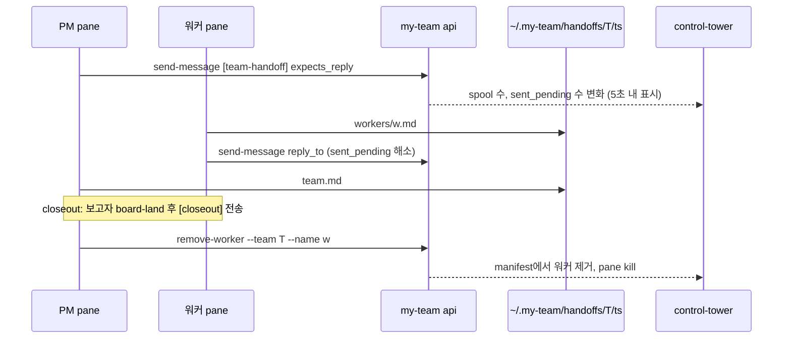
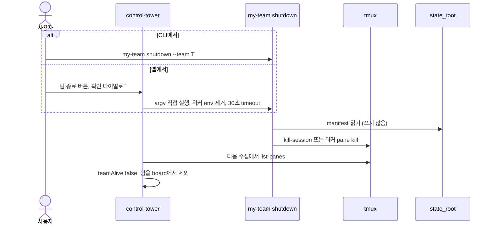

# control-tower × my-team 통합 워크플로우 분석 (T3)

- 대상: `tools/my-team` (Node CLI), `tools/control-tower` (Swift 앱), `plugins/workflow/skills/my-team*`. 기준 커밋 `6c0ca46`. 설치본 `my-team --version` = `0.1.0 (6c0ca4675f81)`로 레포와 같다.
- 모듈 내부는 [T1 my-team 아키텍처](my-team-architecture.md)와 [T2 control-tower 아키텍처](control-tower-architecture.md)를 정본으로 보고 링크만 단다. 이 문서는 두 프로세스가 맞물리는 지점만 다룬다.
- 경로 약어: `mt/` = `tools/my-team/src/`, `ct/` = `tools/control-tower/Sources/`, `sk/` = `plugins/workflow/skills/`.
- 근거: 모든 사실에 `path:line`. 코드로 확인하지 못한 것은 **추론**으로 표시한다. 실행 검증은 실행 중인 팀을 건드리지 않고 scratchpad에 복사한 state(`MY_TEAM_STATE_ROOT_BASE`, manifest `state_root` 재작성)와 `--dry-run`·pure 명령으로만 했다.

---

## 0. 요약

- 두 도구 사이에 상주 채널은 없다. 연결 수단은 3가지다. (1) control-tower가 `<base>/<team>/` 아래 파일을 5초마다 직접 읽는다 (`ct/TowerApp/Tower.swift:62-67`, `ct/TowerCore/Sources/MyTeam.swift:107-132`). (2) 작업판은 `my-team api board-status|goal-order --json` subprocess로만 읽는다 (`ct/TowerCore/TaskBoard.swift:297-304`). (3) 쓰기는 `my-team start --continue`·`status`·`shutdown` 3개 CLI 호출과 `~/teams/<team>.resume.json` 하나뿐이다 (`ct/TowerApp/TeamLaunch.swift:119-131`, `:281-295`).
- 가장 심각한 불일치 2건은 둘 다 control-tower의 '팀 실행' 재기동 경로에 있다. role 없는 팀(peer 팀)은 manifest의 `"role": null`이 `.resume.json`에 그대로 실려 my-team parser가 거부한다(§3 #1, 신규). fresh-continue로 뜬 run은 history에서 팀 run으로 인식되지 않아 다음 재기동이 오래된 run의 워커 구성을 되살린다(§3 #2, T1 §6-1 확정).
- 경로 가정이 세 갈래로 갈린다. config 기본 `state_root`는 `MY_TEAM_STATE_ROOT_BASE`를 무시하고, manifest 탐색은 base를 따르며, handoff 위치는 `~/.my-team/handoffs` 고정이다. base 밖 `state_root`인 팀은 my-team api 자체가 manifest를 못 찾는다(§3 #3).
- 계약 18+12개는 겹치는 것을 합쳐 20개로 정리했다(§2). 대부분 my-team이 producer, control-tower가 consumer이고, 양쪽 공유 테스트는 없다(§3 #5).
- T1·T2의 추론 항목 중 3건은 이번에 실행으로 확정했고(commander 문구, `withoutResume` 규칙 일치, base 밖 state_root), 1건은 정정했다(§5).

---

## 1. 사용자 시나리오별 흐름

### 1.1 (a) 팀 start → 워커 부팅 → 활동 → control-tower 표시 → 더블클릭 이동

| 단계 | 쓰는 쪽 | 읽는 쪽 |
|---|---|---|
| 1. 중복 기동 거부 | - | my-team: tmux 세션명 + manifest liveness (`mt/commands/start.js:255`, `mt/lib/team-liveness.js:49-57`) |
| 2. state 준비 | my-team: `--continue` 없으면 `<root>.<ts>.bak`으로 rename, board 미완 요약을 stderr로 (`mt/commands/start.js:156-175`) | - |
| 3. topology | my-team: `$TMUX` 없으면 detached 세션 `my-team-<team>-<ts36>` (`mt/lib/tmux-session.js:200-229`) | - |
| 4. 워커 overlay·spawn | my-team: `workers/<w>/AGENTS.md` (`mt/commands/start.js:357`), hook `--settings` (`:374-378`), env 3종 (`:385-391`), spawn (`:393`) | 워커 LLM이 AGENTS.md를 읽는다 |
| 5. ready·이름표 | my-team: `waitForPaneReady` 30초 (`mt/commands/start.js:420`), `@worker_name` 재설정 (`:428`) | control-tower liveness가 이 옵션을 본다 (`ct/TowerCore/Sources/MyTeam.swift:152`) |
| 6. startup notice | my-team: `fullNotice` "Team is live. ..." (`mt/lib/startup-notice.js:20-22`)를 `send-keys` (`mt/commands/start.js:440-451`) | 워커 transcript의 첫 prompt가 된다. control-tower history가 이 접두어로 팀 워커를 식별한다 (`ct/TowerCore/Sources/History.swift:312-315`) |
| 7. detached면 monitor | my-team: host pane에 `my-team monitor <team>` (`mt/commands/start.js:462-474`) | events.jsonl tail. control-tower는 events.jsonl을 읽지 않는다 ([T2 §2.1](control-tower-architecture.md#21-my-team-워커-데이터-파일-직접-읽기)) |
| 8. manifest 저장 | my-team: `atomicWriteJson` 0600 (`mt/commands/start.js:478`, `mt/lib/fs-utils.js:18-24`) | control-tower `loadTeams` (`ct/TowerCore/Sources/MyTeam.swift:124-126`). 이 시점 전에는 팀이 board에 보이지 않는다 |
| 9. 워커 상태 | 워커 LLM: `workers/<w>/status.json` (`mt/lib/worker-bootstrap.js:229`, `:271-280`) | control-tower: `state`·`reason`·`updated_at` (`ct/TowerCore/Sources/MyTeam.swift:156-161`) |
| 10. 메시지 | `api send-message` → 송신자 `sent_pending` (`mt/lib/tmux-comm.js:446-456`), archive out (`:459`), spool drop (`:462`), `new-message` 트리거 (`:465`) | 수신자 `mailbox-list`가 spool 흡수 (`mt/lib/tmux-comm.js:258`, `:295`, `:308-310`). control-tower: spool 파일 수, inbox·sent_pending 수, 가장 이른 `sent_at` (`ct/TowerCore/Sources/MyTeam.swift:153`, `:183-203`) |
| 11. 작업판 | `api board-*` 쓰기 → board.db → events.jsonl `board` 줄 → `[board] <ref> <action>` 메일 (`mt/board/core/service.js:137-148`, `mt/board/compose.js:56`, `:71`) | control-tower: manifest에 `board` 키가 있는 **살아 있는** 팀만 `board-status` 호출 (`ct/TowerCore/TaskBoard.swift:321-325`, `ct/TowerCore/Collect.swift:183`). 창이 다 닫히면 15초 주기 (`ct/TowerApp/Tower.swift:127-131`, `:345-347`) |
| 12. my-turn·알림 | - | control-tower: `(wait && spool == 0) || permission prompt` (`ct/TowerCore/Status.swift:7-8`), false→true 전이만 알림 (`ct/TowerApp/Tower.swift:99-101`) |
| 13. 더블클릭 | - | 행 메뉴 첫 항목 `.focus` (`ct/TowerApp/BoardView.swift:222`, `:259-268`) → `planFocus`: attached면 `select-window`+`select-pane`+Ghostty, detached면 Ghostty 새 창에서 `tmux attach` (`ct/TowerCore/Focus.swift:70-92`). Ghostty 탭 좁히기 (`ct/TowerApp/Tower.swift:176-189`) |
| 14. 상세 terminal | control-tower: `tmux -C attach-session`, 입력은 `send-keys -H`, 붙여넣기는 `set-buffer`+`paste-buffer` (`ct/TowerApp/PaneControl.swift:137-162`, `:167-176`) | 상세 화면 `PaneTerminal(ref:)` (`ct/TowerApp/BoardView.swift:787`) |

control-tower의 '새 팀 만들기'는 직접 start하지 않는다. Ghostty에서 claude를 띄워 `~/teams/<team>.json`을 쓰고 `my-team start --config`를 실행하라는 prompt를 넣을 뿐이다 (`ct/TowerApp/TeamLaunch.swift:160-173`).

### 1.2 (b) fresh-continue 재기동

| 단계 | 쓰는 쪽 | 읽는 쪽 |
|---|---|---|
| 1. 경로 결정 | - | control-tower: history에서 그 팀의 마지막 run이 있으면 `.resume`, 없으면 `.start` (`ct/TowerApp/TeamLaunch.swift:384-386`, `ct/TowerApp/Tower.swift:244-252`). run 판정은 `member`가 있는 transcript만 쓴다 (`ct/TowerApp/Sidebar.swift:241-259`) |
| 2. 재기동 config (resume 경로) | control-tower: `~/teams` 최신 config + manifest 워커의 `name, role, agent_type, cwd, description, launch_args` 덮어쓰기 + manifest `group` 보충 (`ct/TowerApp/TeamLaunch.swift:179-198`). claude 워커는 `withoutResume` (`:29-34`, `:42-55`). 작업 폴더 없는 워커 제외 (`:96-101`) | manifest는 `<stateBase>/<team>/manifest.json` 고정 경로로 읽는다 (`ct/TowerApp/TeamLaunch.swift:185`) |
| 3. 셸 스크립트 | 터미널 셸이 `.resume.json`을 쓴다 (`ct/TowerApp/TeamLaunch.swift:123`). 앱 프로세스는 파일을 쓰지 않는다 (`:6`) | `status --team --json`의 `team_alive`로 이미 떠 있으면 attach만 (`ct/TowerApp/TeamLaunch.swift:121-122`, `mt/commands/status.js:64-73`) |
| 4. `start --continue` | my-team: state_root 유지 (`mt/commands/start.js:156-160`), 이전 `started_at` 읽기 (`:285-287`), overlay 덮어쓰기 전 이전 AGENTS.md 보관 (`:355-357`) | - |
| 5. notice 선택 | my-team: 이전 AGENTS.md 있고 claude가 `--resume/-r/--continue/-c` 없이 뜨면 `recoverNotice` (`mt/lib/startup-notice.js:29-32`, `:66-68`, `:91-99`) | handoff: `~/.my-team/handoffs/<team>/` 중 mtime ≥ 이전 `started_at`인 최신 묶음의 `workers/<w>.md`, 없으면 `team.md` (`mt/lib/startup-notice.js:107-120`) |
| 6. 새 대화 워커 | 워커가 `board-status {"open":true}`, handoff 파일, `mailbox-list`로 이어간다 (`mt/lib/startup-notice.js:92-97`) | - |
| 7. attach | - | `status --team --json`의 `session`(`manifest.session_name`, `:0` 포함)으로 `tmux attach -t` (`ct/TowerApp/TeamLaunch.swift:126-128`). `:0` 접미사는 tmux가 받아들인다 (`tmux has-session -t my-team-my-team-mwsxkf6b:0` rc=0으로 확인) |
| 8. 진행 표시 | - | `TeamLaunches`가 팀이 보이거나 120초가 지날 때까지 '띄우는 중' (`ct/TowerApp/TeamLaunch.swift:135-156`, `ct/TowerApp/Tower.swift:103`) |

세션 인자 제거 규칙은 세 곳에 있다. `continuesConversation`은 `--resume`, `-r`, `--resume=`, `--continue`, `-c`를 본다 (`mt/lib/startup-notice.js:29-32`). control-tower `withoutResume`는 같은 5개를 지운다 (`ct/TowerApp/TeamLaunch.swift:42-55`). manifest 저장용 `stripSessionArgs`는 여기에 `--session-id`, `--fork-session`을 더 지운다 (`mt/commands/start.js:59-72`). 앞의 둘은 일치한다. T2 C10의 **추론**은 이것으로 확정했다.

### 1.3 (c) handoff / closeout

- handoff: PM이 묶음 디렉터리를 만들고 (`sk/my-team-handoff/SKILL.md:37`) 전원에게 `[team-handoff]`를 `expects_reply`로 보낸다 (`:49-50`). 워커는 `workers/<w>.md`를 쓰고 `reply_to`로 회신한다 (`:115-116`). shutdown은 하지 않는다 (`:85`). 묶음 위치는 state_root 밖에 둔다 (`:40`). 다음 start의 `lastHandoff`가 같은 `$HOME/.my-team/handoffs` 고정 경로를 읽는다 (`mt/lib/startup-notice.js:107`). 상세 절차는 [T1 §3.9](my-team-architecture.md#39-handoff--takeover--closeout--resume-스킬-흐름).
- control-tower는 handoff 묶음을 읽지 않는다 (`ct/` 전체에서 `handoffs` grep 결과 없음). 이 흐름은 control-tower에 메일 카운트 변화로만 보인다: PM의 `sent_pending`(미응답자 수)과 가장 이른 `sent_at` (`ct/TowerCore/Sources/MyTeam.swift:199-202`).
- takeover: 재기동 후 PM이 최신 묶음을 `ls -td`로 찾고 (`sk/my-team-takeover/SKILL.md:31`) `board-status open:true`를 기준으로 대조한다 (`:40`). `[team-takeover]` 브리프를 보낸다 (`:99`).
- closeout: 보고자는 `board-land`·판정 후 spawner에게 `[closeout]`을 `reply_to`=티켓, `expects_reply`로 보낸다 (`sk/my-team-closeout/SKILL.md:15`, `:52-56`). 수신자가 검증 후 `remove-worker`를 실행한다 (`:84`). remove-worker는 manifest를 다시 읽어 splice 후 atomic write하고 (`mt/commands/remove-worker.js:40-52`), 살아 있는 pane만 kill한다 (`:57-59`). control-tower는 다음 5초 수집에서 manifest에 없는 워커를 표시하지 않는다(manifest가 워커 목록의 유일한 출처, `ct/TowerCore/Sources/MyTeam.swift:148`). state 파일과 worktree는 남는다 ([T1 §3.5](my-team-architecture.md#35-remove-worker)).

### 1.4 (d) 팀 shutdown

- my-team: 모드별로 detached는 세션 전체, split-pane은 살아 있는 워커 pane만, dedicated-window는 살아 있을 때만 window를 kill한다 (`mt/commands/shutdown.js:34-48`). state_root와 manifest는 남긴다 (`:50-51`).
- 앱: '팀 종료…' (`ct/TowerApp/BoardView.swift:202`, `:208`) → 다이얼로그 확인 (`:1005`) → `[myTeam, "shutdown", "--team", team]`을 `myTeamEnvironment()`로 실행 (`ct/TowerApp/Tower.swift:263-271`, `ct/TowerApp/TeamLaunch.swift:295`, `ct/TowerCore/Support.swift:97-99`). 다이얼로그 문구가 "작업판·메일·manifest는 남는다"고 안내한다 (`ct/TowerApp/TeamLaunch.swift:341-345`).
- 반영: 다음 수집에서 `teamAlive`가 false가 되어 팀이 board에서 빠지고 (`ct/TowerCore/Collect.swift:183`), `shutdowns.settle`이 진행 표시를 지운다 (`ct/TowerApp/Tower.swift:104`). 해당 팀의 작업판 상태도 다음 읽기에서 빠진다 (`ct/TowerApp/Tower.swift:144`).
- 남은 manifest는 다음 '팀 실행'의 `teamBase` 입력이 된다 (§1.2 단계 2).

---

## 2. 공유 경계 계약표

T1 [§5.1](my-team-architecture.md#51-계약-목록)의 C1–C18과 T2 [§4](control-tower-architecture.md#4-my-team과-공유하는-경계-계약)의 C1–C12를 합친 표다. 번호 M은 이 문서의 것이다. "버전 의존"은 상수·접두어·키 이름처럼 한쪽만 바꾸면 깨지는 값이다.

| M | 계약 (T1 / T2) | 쓰는 쪽 | 읽는 쪽 | 버전 의존 | 바뀌면 깨지는 쪽 |
|---|---|---|---|---|---|
| M1 | state base, 팀 디렉터리 = 팀명, `.bak`·`.omc` 제외 (T1 C1 / T2 C1) | `mt/config/parser.js:145-146`(config에 `state_root`가 없으면 `~/.my-team/sessions/<team>` 고정, `MY_TEAM_STATE_ROOT_BASE` 무시), `mt/commands/start.js:98-104`(backup 이름) | `ct/TowerCore/Sources/MyTeam.swift:7-13`, `:120`; `mt/commands/status.js:51-54`; `mt/lib/state-root.js:34-39`, `mt/commands/_manifest.js:10-12` (모두 base env를 따름) | `.bak` 접미사 | CT: 팀 누락 또는 사본을 팀으로 표시 (§3 #4) |
| M2 | `manifest.json` 필수 필드 `team_name, state_root, session_name, workers[].name, pane_id` (T1 C2 / T2 C2) | `mt/commands/start.js:302-313`, `:401-415`, `:478`; `mt/commands/add-worker.js:300-311`; `mt/commands/remove-worker.js:52` | `ct/TowerCore/Sources/MyTeam.swift:16-40`, `:124-130` | snake_case 키 | CT: decode 실패 시 그 팀 skip |
| M3 | manifest 선택 필드 `group`, `board`(존재만), `started_at`, `workers[].role/cwd/agent_type/description/launch_args` (T1 C2 / T2 C2, C8) | `mt/commands/start.js:308-310`, `:401-415` | 표시: `ct/TowerCore/Sources/MyTeam.swift:22-24`, `:146-147`. 재기동: `ct/TowerApp/TeamLaunch.swift:189-196` | `role`이 `null`일 수 있음 (`mt/commands/start.js:407`) | CT 재기동: `null` 그대로 `.resume.json`에 실림 (§3 #1) |
| M4 | `session_name`의 `:<window>` 접미사 (T1 C3 / T2 C3 일부) | `mt/lib/tmux-session.js:217-228` | `mt/lib/team-liveness.js:39`, `ct/TowerCore/Sources/MyTeam.swift:138`, `:206`, `ct/TowerApp/TeamLaunch.swift:126-128` | `:` 구분자 | 양쪽 liveness·attach |
| M5 | liveness = (session, `@worker_name`, pane_id) (T1 C4 / T2 C3) | `mt/commands/start.js:428`, `mt/lib/tmux-session.js:52-60` | `mt/lib/team-liveness.js:38-46`, `ct/TowerCore/Sources/MyTeam.swift:134-152` | pane 옵션 이름 | 양쪽. 로직이 복제돼 있다 (§3 #5) |
| M6 | `mailbox/<w>.json` `schema_version` 2, `inbox`·`sent_pending` 맵, `sent_at` (T1 C5 / T2 C5) | `mt/lib/tmux-comm.js:54`, `:446-456` | `mt/lib/handler-guards.js:48-58`, `ct/TowerCore/Sources/MyTeam.swift:183-203` | `MAILBOX_SCHEMA_VERSION = 2` (`mt/lib/tmux-comm.js:54`), CT 하드코딩 `2` (`ct/TowerCore/Sources/MyTeam.swift:192`) | CT: 전 워커 `reason`이 "mailbox unreadable" |
| M7 | `incoming-spool/<w>/*.json` 개수 (T1 C6 / T2 C5) | `mt/lib/tmux-comm.js:234`, `:462`, `mt/lib/state-paths.js:34-36` | `ct/TowerCore/Sources/MyTeam.swift:153`, `:177-179`; my-turn 판정 (`ct/TowerCore/Status.swift:7-8`) | `.json` 확장자 | CT: spool 0으로 silent failure, my-turn 오판 |
| M8 | `workers/<w>/status.json` `{state, reason, updated_at}` (T1 C7 / T2 C4) | 워커 LLM, 지시문 `mt/lib/worker-bootstrap.js:229`, `:271-280` | `mt/commands/status.js:20-26`, `ct/TowerCore/Sources/MyTeam.swift:156-161` | AGENTS.md 문구 | CT: 상태 칸 공란 (형식 보장 없음) |
| M9 | `api board-status` JSON (`ok, store, tasks, workers, open_findings, recent, announcements, decisions`) (T1 C8 / T2 C6) | `mt/commands/api/board-status.js:6-9`, `mt/board/core/queries.js:256` | `ct/TowerCore/TaskBoard.swift:7-29`, `:230-238` | 필수 키 이름. 복사본 실행 결과 키 8개 확인 | CT: `.unreadable` |
| M10 | board 에러 `{ok:false, code, message}`와 code (`forbidden`, `schema-too-new`, `board-unavailable`, `busy`) (T1 C9 / T2 C6) | `mt/cli.js:65-82`, `mt/board/core/contract.js:128-133` | `ct/TowerCore/TaskBoard.swift:270-287`, `:800-802`, `:827` | code 문자열 | CT: 원인별 안내 대신 일반 오류 |
| M11 | board.db `SCHEMA_VERSION` 6, 읽기 열기 무변경 (T1 C10 / T2 C7) | `mt/board/core/contract.js:36`, `mt/board/store/sqlite/index.js:104-113` | CT는 직접 열지 않음. `schema-too-new` 코드로만 인지 (`ct/TowerCore/TaskBoard.swift:801`) | PATH의 my-team 사본 (`ct/TowerCore/Focus.swift:59`) | 팀을 띄운 my-team보다 앱이 쓰는 사본이 낡으면 CT 작업판 실패 |
| M12 | `api goal-order` JSON, 미지원 판정 (T1 C11 / T2 C6) | `mt/commands/api/goal-order.js:73-81` | `ct/TowerCore/GoalOrder.swift:9-23`, `:69-76` | commander `unknown command '<x>'` 문구 (§3 #10) | CT goal 순서 뷰 |
| M13 | CT가 `MY_TEAM_WORKER`, `MY_TEAM_STATE_ROOT`, `OMC_TEAM_WORKER` 제거 후 호출 (T1 C12 / T2 C6) | `ct/TowerCore/TaskBoard.swift:257`, `:300`; `ct/TowerCore/Support.swift:97-99` | `mt/board/compose.js:82-103` | 변수 이름 | CT: `forbidden` (복사본에서 `MY_TEAM_WORKER=other/x`로 재현) |
| M14 | `status --team <t> --json`의 `team_alive`, `session` (T1 C13 / T2 C9) | `mt/commands/status.js:56-73` | `ct/TowerApp/TeamLaunch.swift:121`, `:126`, `:283`, `:287` (`plutil -extract`) | 키 이름 | CT: 이중 start 또는 attach 실패 |
| M15 | `start --continue --config`, `shutdown --team` 의미 (T1 C14 / T2 C10) | CT argv·스크립트 `ct/TowerApp/TeamLaunch.swift:123`, `:285`, `:295` | `mt/cli.js:100-116`, `:145-152`; `mt/commands/start.js:156-175`; `mt/commands/shutdown.js:50-51` | 플래그 이름 | `--continue` 의미가 바뀌면 CT 재기동이 state를 `.bak`으로 보냄 |
| M16 | 세션 인자 규칙 (T1 C14 일부 / T2 C10) | CT `withoutResume` `ct/TowerApp/TeamLaunch.swift:42-55` | `mt/lib/startup-notice.js:29-32` | 인자 목록 5개 | 한쪽만 추가하면 recoverNotice 대신 diff notice가 감 |
| M17 | `~/teams/*.json` config (`team_name`, `workers[]`, `group`, worker 필드), `.resume.json` (T1 C15 / T2 C8, C10) | 사용자·`my-team-config` 스킬, CT 재기동 셸 (`ct/TowerApp/TeamLaunch.swift:123`) | `mt/config/parser.js:117-187`, `:264-276`; CT 목록 `ct/TowerApp/TeamLaunch.swift:242-276` | parser 검증 규칙 | my-team이 CT가 쓴 `.resume.json`을 거부 (§3 #1) |
| M18 | 워커 첫 prompt 접두어 `Team is live.` / `You just joined team ` + `/sessions/<team>/workers/<w>/` (T1 C16 / T2 C11) | `mt/lib/startup-notice.js:21`, `:71`, `:80`, `:97`; `mt/commands/add-worker.js:348` | `ct/TowerCore/Sources/History.swift:312-315`, `ct/TowerApp/Sidebar.swift:241-259` | 문구 접두어, `/sessions/` 경로 | CT history·팀 실행 (§3 #2) |
| M19 | 팀 문서 폴더 `dirname(base)/docs/<team>/` (T1 C17 / T2 C12) | 사람·PM (`goals/G<n>-*.md`, `index.md`) | `mt/commands/api/goal-order.js:33`, `ct/TowerCore/Documents.swift:256-259` | 폴더 이름 | CT 문서 탭, goal-order |
| M20 | handoff 묶음 `~/.my-team/handoffs/<team>/<ts>/` (T1 §2.9, CT 무관) | `sk/my-team-handoff/SKILL.md:37` | `mt/lib/startup-notice.js:107-120`, `sk/my-team-takeover/SKILL.md:31` | `$HOME` 고정 | recoverNotice가 handoff를 못 가리킴 |

T1 C18(`[board]`·`new-message:` 문구)은 control-tower가 파싱하지 않는다. my-team 내부 계약으로 두고 표에서 뺐다.

---

## 3. 불일치·깨지기 쉬운 지점 통합 목록

심각도 순. 출처 표기: T1 = [T1 §6](my-team-architecture.md#6-발견한-불일치의심-지점-수정하지-않음), T2 = [T2 §6](control-tower-architecture.md#6-확인된-불일치위험-수정하지-않음).

**#1 [높음, 신규] peer 팀의 '팀 실행' 재기동이 `role: null`로 실패한다.**
- my-team은 role 없는 워커를 manifest에 `"role": null`로 저장한다 (`mt/commands/start.js:407`). control-tower `teamBase`는 manifest 워커의 `role` 키를 값 검사 없이 덮어쓴다 (`ct/TowerApp/TeamLaunch.swift:189`, `:194-196`). `resumeConfig`는 `launch_args`만 손댄다 (`:29-34`). my-team parser는 `role` 키가 있으면 `orchestrator|worker`만 허용한다 (`mt/config/parser.js:269-275`).
- 결과: history에 run이 있는 peer 팀을 '팀 실행'하면 터미널에 `workers[0].role must be one of orchestrator|worker. Got: null`이 뜨고 멈춘다. 현재 `~/.my-team/sessions/grafana-dashboard/manifest.json`이 `"role": null`을 갖는다(grep 확인). control-tower 테스트는 role이 문자열이거나 키가 없는 경우만 다룬다 (`tools/control-tower/Tests/TowerAppTests/TeamLaunchTests.swift:77-89`, `:145`).
- 재현:
  1. `swift` 스크립트로 `teamBase`의 병합 식(`TeamLaunch.swift:186-196`)을 `{"role":null}` manifest에 적용하면 출력 JSON에 `"role":null`이 남는다(scratchpad에서 실행 확인).
  2. 그 JSON을 파일로 두고 `env -u MY_TEAM_WORKER -u MY_TEAM_STATE_ROOT -u OMC_TEAM_WORKER MY_TEAM_STATE_ROOT_BASE=<tmp>/base my-team start --dry-run --config <tmp>/peer.resume.json` → exit 1, 위 에러. `--dry-run`은 검증만 하고 state를 쓰지 않는다 (`mt/commands/start.js:265-277`).
  3. 앱 전체 경로는 `tools/control-tower/scripts/test-instance.sh`의 격리 HOME에 role 없는 팀 manifest와 history transcript를 두고 '팀 실행'을 누른다 (**추론**: 앱 클릭으로는 재현하지 않음).

**#2 [높음, T1 §6-1 확정 + T2 C11] fresh-continue run이 history에서 팀 run으로 인식되지 않는다.**
- control-tower는 첫 prompt가 `Team is live.` 또는 `You just joined team `으로 시작해야 `member`를 붙인다 (`ct/TowerCore/Sources/History.swift:313`). `--continue`로 뜬 워커의 notice 3종은 모두 `Team is live again`으로 시작한다 (`mt/lib/startup-notice.js:71`, `:80`, `:97`). `"Team is live again"`의 13번째 글자는 `.`이 아니라 공백이다.
- 영향(코드 경로로 확인): `teamRuns`는 `member` 있는 transcript만 run으로 묶는다 (`ct/TowerApp/Sidebar.swift:243-256`). control-tower의 '팀 실행'은 항상 `--continue`라서 (`ct/TowerApp/TeamLaunch.swift:123`, `:285`) 두 번째 재기동부터 `lastRuns`가 최초 `Team is live.` run을 가리킨다. 그래서 (a) 메뉴의 '마지막 실행' 시각이 낡고 (`ct/TowerApp/TeamLaunch.swift:411-413`), (b) `resumeConfig`가 그 낡은 run의 워커 이름으로 목록을 거른다 (`:16-27`). 이후 run에서 `remove-worker`된 워커가 `added`로 되살아나고, 이후 run에서만 쓰던 워커는 빠진다. (c) fresh-continue 워커 transcript는 `member == nil`이라 history의 단독 claude 세션 목록에 섞인다 (`ct/TowerApp/Sidebar.swift:271-274`).
- 재현: `node -e "import('./tools/my-team/src/lib/startup-notice.js').then(m=>{const p='/x/.my-team/sessions/t/workers/w/AGENTS.md';console.log(m.fullNotice(p).startsWith('Team is live.'), m.recoverNotice(p,{board:true}).startsWith('Team is live.'))})"` → `true false` (레포 루트에서 실행 확인). 앱 쪽 영향은 test-instance에서 같은 팀을 '팀 실행' → '팀 종료' → '팀 실행' 두 번 반복한 뒤 메뉴 부제의 시각과 워커 수를 본다 (**추론**: 앱으로 재현하지 않음).

**#3 [중간, T1 §6-6·§6-7 + T2 §6-3 + T2 C11 통합] state_root 위치 가정이 세 갈래다.**
- config 기본 `state_root`는 `~/.my-team/sessions/<team>` 고정이고 `MY_TEAM_STATE_ROOT_BASE`를 무시한다 (`mt/config/parser.js:146`). manifest 탐색은 `<base>/<team>/manifest.json`이고 base는 env를 따른다 (`mt/commands/_manifest.js:10-12`, `:37-40`). api 명령은 `--state-root`를 받지 않고 이 경로만 본다 (`mt/cli.js:137`, `:149`, `:158`, `:182`, `:194`는 사용자 명령에만 있음). control-tower도 `<base>/<dir>/manifest.json`만 읽고 (`ct/TowerCore/Sources/MyTeam.swift:124`), 재기동은 `<stateBase>/<team>/manifest.json`을 본다 (`ct/TowerApp/TeamLaunch.swift:185`). history 팀 식별은 경로에 `/sessions/`가 있어야 한다 (`ct/TowerCore/Sources/History.swift:314`).
- 결과: config `state_root`를 base 밖으로 준 팀은 start는 되지만 워커의 `api send-message`·`mailbox-list`·`board-*`가 manifest를 못 찾는다. control-tower에는 팀이 보이지 않는다. T2 §6-3은 "재개 시 manifest 정보 손실"로 적었지만 실제로는 my-team api부터 동작하지 않는다(§5 정정). base env를 준 환경에서는 반대로 start가 env를 무시한 위치에 state를 만든다.
- 재현: `S=<tmp>; mkdir -p $S/custom/zz; echo '{"team_name":"zz","state_root":"'$S'/custom/zz","session_name":"nope:0","workers":[{"name":"a","pane_id":"%999"}]}' > $S/custom/zz/manifest.json; MY_TEAM_STATE_ROOT_BASE=$S/base my-team api roster --input '{"team_name":"zz"}' --json` → `manifest not found at $S/base/zz/manifest.json`. 같은 manifest를 `my-team status --team zz --json --state-root $S/custom/zz`로는 읽는다(둘 다 실행 확인, `MY_TEAM_*` 워커 변수는 unset).

**#4 [중간, 신규, T1 C1 / T2 C1 관련] `.bak`로 끝나지 않는 state 사본이 살아 있는 두 번째 팀으로 보인다.**
- 양쪽 모두 이름이 `.bak`로 끝나는 디렉터리만 거른다 (`mt/commands/status.js:51-54`, `ct/TowerCore/Sources/MyTeam.swift:120`). liveness는 manifest의 session·pane·`@worker_name`만 보므로 사본 manifest도 원본과 같은 답을 낸다 (`mt/lib/team-liveness.js:38-46`). 현재 base에 `run-mate.bak-2026-10-09/manifest.json`이 있다(`ls` 확인). run-mate가 살아 있으면 같은 이름의 팀이 둘로 보인다. control-tower에서 두 팀의 worker handle(`pane:<session>:<pane>`, `ct/TowerCore/Sources/MyTeam.swift:216`)이 겹칠 때의 UI 동작은 **추론**.
- 재현: 복사 base에 `cp <tmp>/base/my-team/manifest.json <tmp>/base/my-team.bak-x/` 후 `MY_TEAM_STATE_ROOT_BASE=<tmp>/base my-team status --all --json` → `[('my-team', True), ('my-team', True)]` (실행 확인 후 사본 삭제). 메모리의 "copied manifest" 주의사항과 같은 원인이다.

**#5 [중간, T2 §6-4] liveness·mailbox 규칙이 Swift로 복제돼 있고 계약 테스트가 없다.**
- M5·M6 로직과 에러 문구까지 복제했다 (`ct/TowerCore/Sources/MyTeam.swift:134-152`, `:192-197` ↔ `mt/lib/team-liveness.js:38-46`, `mt/lib/handler-guards.js:48-58`). CT 테스트는 손으로 쓴 manifest를 쓰고 (`tools/control-tower/Tests/TowerCoreTests/MyTeamStateTests.swift:19-25`), E2E용 가짜 my-team은 `board-status`만 흉내 낸다 (`tools/control-tower/scripts/test-instance/fake-my-team.py:3`, `:23-24`). #1·#2가 양쪽 테스트를 모두 통과한 채 남은 이유다.
- 재현: `MAILBOX_SCHEMA_VERSION`을 3으로 바꾼 사본으로 `cd tools/my-team && npm test`와 `cd tools/control-tower && swift test`를 돌리면 control-tower 쪽은 실패하지 않는다(**추론**: 실제로 상수를 바꿔 돌리지는 않음, 코드 수정 금지 범위).

**#6 [중간, T1 §6-5] manifest가 startup notice 이후에 저장된다.**
- notice 입력(`mt/commands/start.js:440-451`) 뒤에 manifest를 쓴다 (`:478`). `--continue`에서는 그 사이 이전 run의 manifest(옛 session·pane)가 남아 있다. 이 창에서 워커가 보낸 메시지의 트리거는 `paneOwnedBy`에서 거부돼 spool에만 남고 (`mt/lib/tmux-comm.js:330-353`, `:465`), control-tower는 옛 session을 보고 팀을 dead로 판정해 숨긴다 (`ct/TowerCore/Collect.swift:183`). 실제 경합 빈도는 **추론**.
- 재현: 복사 state로 detached 팀을 띄우는 probe 팀(메모리 "Probe team: --detached, then clean" 절차)을 `start --continue`로 기동하면서, 별도 셸에서 `watch -n0.5 'jq -r .session_name <tmp>/base/<team>/manifest.json'`로 notice 출력 시점과 manifest 갱신 시점을 비교한다.

**#7 [낮음~중간, T1 §6-4] `mailbox-list`·`mailbox-mark-delivered`에 actor 고정이 없다.**
- send-message와 board는 `MY_TEAM_WORKER`로 호출자를 고정한다 (`mt/commands/api/send-message.js:76-93`, `mt/board/compose.js:82-95`). mailbox 두 명령은 입력 `worker`를 그대로 쓴다 (`mt/commands/api/mailbox-list.js:36-48`, `mt/commands/api/mailbox-mark-delivered.js:55-66`, `mt/lib/handler-guards.js:19-28`). 다른 워커의 spool을 흡수하면 control-tower의 그 워커 spool 수가 0이 되어 my-turn이 켜진다 (`ct/TowerCore/Status.swift:7-8`).
- 재현: 복사 base에서 `MY_TEAM_WORKER=my-team/pm MY_TEAM_STATE_ROOT_BASE=<tmp>/base my-team api mailbox-list --input '{"team_name":"my-team","worker":"analyst"}' --json`이 거부되지 않는지 본다. 이 명령은 사본의 mailbox를 쓴다(원본 금지).

**#8 [낮음, T2 §6-1·§6-6·§6-7 + T1 §6-3 + 신규 2건] 문서·주석이 코드와 어긋난다.**
- control-tower README "It never types into a pane" (`tools/control-tower/README.md:5`)와 FocusRunner 주석 (`ct/TowerApp/FocusRunner.swift:12-13`) ↔ `PaneStream.send`/`paste` (`ct/TowerApp/PaneControl.swift:167-176`). Tmux.swift의 "읽기 전용" 주석(`ct/TowerCore/Sources/Tmux.swift:3`)은 TowerCore 한정이라 모순은 아니다(T2 §6-7은 이 항목에 흡수).
- [신규] README '팀 실행' 설명이 "each claude worker resuming its last conversation (`--resume <id>` in a `.resume.json`)"이라고 적는다 (`tools/control-tower/README.md:93-95`). 코드는 `--resume`을 지운다 (`ct/TowerApp/TeamLaunch.swift:10-14`, `:29-34`). `Tower.resumeTeam`·`launchTeam` doc 주석도 같은 옛 서술이다 (`ct/TowerApp/Tower.swift:221`, `:242-243`). 커밋 `f111228` 이후 갱신되지 않은 것으로 보인다(경위 **추론**).
- README 데이터 소스 표(`tools/control-tower/README.md:251-260`)에 `~/teams`, `~/.my-team/docs`, usage 원장, `status/start/shutdown` 호출이 없다(T2 §6-6 재확인).
- my-team 스킬: "state를 비우는 건 shutdown뿐" (`sk/my-team/SKILL.md:79`), "No task lifecycle" (`:92`), "shutdown이 메일박스를 치우므로" (`sk/my-team-handoff/SKILL.md:68`) ↔ shutdown은 state를 남긴다 (`mt/commands/shutdown.js:50-51`).
- [신규] closeout 스킬은 `closeout-context.sh`를 "읽기 전용"이라 하지만 (`sk/my-team-closeout/SKILL.md:29`, `sk/my-team-closeout/scripts/closeout-context.sh:3`) 스크립트가 mutating인 `api mailbox-list`를 부른다 (`closeout-context.sh:14`, spool 흡수 `mt/commands/api/mailbox-list.js:48`).
- 재현: 각 줄을 `sed -n '<line>p' <file>`로 대조한다.

**#9 [낮음, T1 §6-2] `start --detached`, `--new-window` 플래그가 무시된다.**
- 옵션은 정의되지만 (`mt/cli.js:110-111`) `resolveConfig`가 반영하지 않고 (`mt/commands/start.js:207-230`), topology는 `$TMUX`와 config `new_window`만 본다 (`mt/lib/tmux-session.js:200-212`, `mt/commands/start.js:294-296`). config `detached`는 정규화만 되고 읽는 곳이 없다 (`mt/config/parser.js:183`). control-tower 경로는 tmux 밖 Ghostty 셸에서 start하므로 항상 detached라 영향이 없다 (`ct/TowerApp/TeamLaunch.swift:119-131`).
- 재현: tmux pane 안에서 probe 팀을 `my-team start --detached --config <probe>`로 띄우면 출력에 `mode: split-pane`이 찍힌다. probe는 메모리 절차대로 정리한다.

**#10 [낮음, T2 §6-5, 추론 해소] goal-order 미지원 판정이 commander 문구에 의존한다.**
- `unknown command 'goal-order'` 문자열 매칭 (`ct/TowerCore/GoalOrder.swift:71`). 현재 commander `^12.1.0` (`tools/my-team/package.json:15`)은 `error: unknown command '<x>'` + exit 1을 낸다(실행 확인). commander 메이저 업그레이드 때 깨질 수 있다는 위험은 남는다.
- 재현: `node tools/my-team/bin/my-team api goal-orderx --input '{}' --json; echo $?` → `error: unknown command 'goal-orderx'`, `1`.

**#11 [낮음, T2 §6-2] 실행 중 세션 수집이 `CLAUDE_CONFIG_DIR`/`CODEX_HOME`을 무시한다.**
- history는 두 변수를 따르지만 (`ct/TowerCore/Sources/History.swift:94-98`) live 수집은 `~/.claude/sessions`, `~/.claude/projects`, `~/.codex`를 하드코딩한다 (`ct/TowerCore/Sources/Claude.swift:58-61`, `ct/TowerCore/Sources/Codex.swift:135`). my-team 경계와는 무관하지만 워커 transcript 연결(`live` 표시, cache hit rate)에 영향이 있다 (**추론**).
- 재현: `CLAUDE_CONFIG_DIR=<tmp>/claude`로 claude를 띄운 상태에서 `swift run tower-cli --once`의 해당 세션 `transcript`가 비는지 본다.

**#12 [낮음, T1 §6-9] state 일부가 0644, 디렉터리가 0755다.** 0600은 `atomicWriteJson`·`appendFileWithMode`를 거치는 파일(manifest, mailbox, archive)과 board.db뿐이다 (`mt/lib/fs-utils.js:18-41`). state_root·워커 디렉터리(`mt/commands/start.js:174`, `:338`), AGENTS.md(`start.js:357`), guard-settings.json(`mt/lib/worker-guard.js:644`), events.jsonl(`mt/lib/events.js:74-78`)은 mode 없이 만들어 umask를 따른다. 메시지 본문 전문이 담긴 events.jsonl이 가장 민감하다. 재현: `stat -f '%Sp %N' ~/.my-team/sessions/my-team ~/.my-team/sessions/my-team/workers ~/.my-team/sessions/my-team/events.jsonl ~/.my-team/sessions/my-team/workers/*/AGENTS.md` → 디렉터리 `drwxr-xr-x`, 파일 `-rw-r--r--` (확인). 상세는 [T1 §6-9](my-team-architecture.md).

**#13 [정보, T1 §6-8] board 알림은 `message` 이벤트로 남지 않는다.** `boardFor.notify`는 `queueDirectMessage`만 부른다 (`mt/board/compose.js:56`). control-tower는 events.jsonl을 읽지 않아 영향이 없다. 재현: 복사본 `grep -c '"type":"message"' <tmp>/base/my-team/events.jsonl`과 `archive/*.jsonl`의 `[board]` 줄 수를 비교한다.

**#14 [정보, T1 §6-10] 원본 board.db를 `sqlite3 -readonly`로 열 수 없다.** `-wal`·`-shm`이 없는 지금도 `Error: stepping, unable to open database file (14)`가 재현됐다. 원인은 WAL 모드 DB 옆에 `-wal`·`-shm`이 없으면 read-only 연결이 그것을 만들지 못해 error 14가 나는 것이다. `file:...?immutable=1`로는 읽힌다 (T1 §6-10에서 재현). 재현(임시 DB): `cd $(mktemp -d) && sqlite3 b.db 'PRAGMA journal_mode=WAL; create table t(x);' && rm -f b.db-shm b.db-wal && sqlite3 -readonly b.db 'select count(*) from t'; echo $?`. 사람이 볼 때는 사본이나 `my-team api board-status`를 쓴다. 재현: `sqlite3 -readonly ~/.my-team/sessions/my-team/board.db 'PRAGMA user_version;'`.

---

## 4. 추론 항목

- §3 #1 앱 클릭 경로 전체(병합 식과 parser 거부는 각각 실행으로 확인, 앱에서 통째로 재현하지 않음)
- §3 #2 앱의 '마지막 실행' 시각·워커 구성 오류(코드 경로로 확인, 앱 재현 안 함)
- §3 #4 control-tower에서 같은 이름 팀 2개가 겹칠 때의 UI 동작
- §3 #5 schema 상수 변경 시 control-tower 테스트 무반응(상수를 바꿔 돌리지 않음)
- §3 #6 manifest 저장 지연 경합의 실제 발생 빈도
- §3 #8 README·주석 미갱신의 경위
- §3 #11 live/history 경로 불일치의 실제 표시 영향

## 5. T1·T2 목록 대조 결과

| 원 항목 | 처리 | 이유 |
|---|---|---|
| T1 §6-1 | 확정, #2로 승격 | 실행으로 접두어 불일치 확인. `continue` notice 3종 모두 해당 (T1은 recoverNotice만 언급) |
| T1 §6-2 | 유지 #9 | 코드 재확인. control-tower 경로에는 영향 없음을 추가 |
| T1 §6-3 | #8에 병합 | 같은 성격(문서 불일치) |
| T1 §6-4 | 유지 #7 | control-tower spool·my-turn 영향 추가 |
| T1 §6-5 | 유지 #6 | control-tower가 그 사이 팀을 숨기는 영향 추가 |
| T1 §6-6, §6-7 | #3에 병합 | api가 `--state-root`를 못 받는 점을 실행으로 확인해 범위 확대 |
| T1 §6-8, §6-9, §6-10 | 유지 #13, #12, #14 | 재확인. §6-10은 shm 없는 상태에서도 재현 |
| T2 §6-1, §6-6, §6-7 | #8에 병합 | §6-7은 T2 스스로 "모순은 아님"이라 적은 대로 독립 항목에서 뺌 |
| T2 §6-2 | 유지 #11 | my-team 경계 밖이라 낮음 |
| T2 §6-3 | **정정** 후 #3에 병합 | "재개 시 manifest 정보 손실"이 아니라 my-team api 자체가 base 밖 manifest를 못 찾는다 (`mt/commands/_manifest.js:37-40`) |
| T2 §6-4 | 유지 #5 | #1·#2가 이 구조에서 나온 사례 |
| T2 §6-5 | 유지 #10, 추론 해소 | commander 12 문구를 실행으로 확인 |
| T2 C10 추론 | 해소 | `withoutResume`과 `continuesConversation` 인자 목록 일치 (§1.2) |
| T2 C11 추론 | 확정 | #2(문구), #3(경로) |
| T2 §5.1 `EveryGCDWorkerBlocked` 추론 | 범위 밖 | my-team 경계와 무관해 검증하지 않음 |
