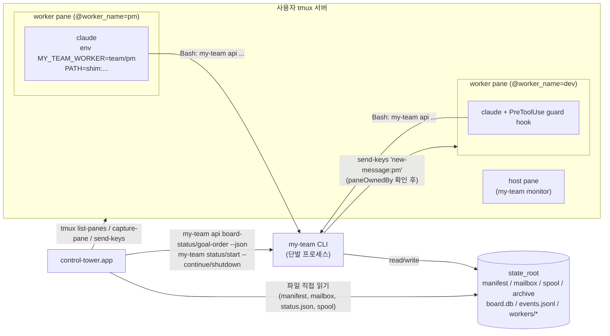

# my-team 아키텍처 분석 (T1)

- 대상: `tools/my-team` (Node CLI), `plugins/workflow/skills/my-team*/SKILL.md` 7개
- 기준 커밋: `6c0ca46` (main). 런타임 예시는 `~/.my-team/sessions/my-team/` (2026-11-23 07:14 UTC 기동 run)
- 표기: 모든 사실 주장에 `path:line`. 코드로 검증하지 않은 것은 **추론**으로 표시한다.
- 범위 밖: control-tower 내부 구조(T2 소관). 이 문서는 control-tower가 my-team과 맞닿는 경계만 다룬다(§5).

---

## 0. 요약

- my-team은 `commander` 하나만 의존하는 ESM Node CLI다 (`tools/my-team/package.json:3-21`). Node 22.13 이상이 필요하고(`package.json:17-19`), 작업판(board)은 `node:sqlite`로 동작한다 (`tools/my-team/src/board/store/sqlite/index.js:1-19`).
- 프로세스 경계는 4개다: 사용자 tmux 서버, my-team CLI(매 호출마다 뜨고 끝나는 단발 프로세스), 각 pane 안의 Claude/Codex 워커, control-tower 앱. 상주 데몬은 없다. 공유 상태는 전부 파일(`state_root`)과 tmux pane 옵션(`@worker_name`)이다.
- 메시지는 "spool 파일 drop → 수신자 `mailbox-list`가 흡수 → `mark-delivered`가 archive로 이동"하는 pull 모델이고, tmux `send-keys` 트리거는 best-effort 알림일 뿐이다 (`tools/my-team/src/lib/tmux-comm.js:388-468`).
- 작업판은 팀별 `board.db`(sqlite, `PRAGMA user_version` = schema 6)이고 쓰기 명령만 migration을 한다 (`tools/my-team/src/board/compose.js:25-35`, `tools/my-team/src/board/core/contract.js:36`).
- control-tower는 `board.db`를 직접 열지 않는다. `my-team api board-status|goal-order --json`을 subprocess로 호출하고, manifest·mailbox·status.json·incoming-spool은 파일로 직접 읽는다 (`tools/control-tower/Sources/TowerCore/TaskBoard.swift:3-4`, `tools/control-tower/Sources/TowerCore/Sources/MyTeam.swift:3-4`).

---

## 1. 모듈 구조

### 1.1 디렉터리와 역할

| 경로 | 역할 | 근거 |
|---|---|---|
| `bin/my-team` | `src/cli.js`를 dynamic import하는 entry | `tools/my-team/bin/my-team:1-5` |
| `shim/tmux` | 워커 PATH 맨 앞에 놓이는 tmux shim. `src/tmux-shim.js`를 import | `tools/my-team/shim/tmux:1-5`, `tools/my-team/src/lib/tmux-session.js:134-137` |
| `src/cli.js` | commander 정의. 사용자 명령 7개 + `api` 하위 명령 | `tools/my-team/src/cli.js:92-267` |
| `src/commands/*.js` | 사용자 명령 handler (start, solo, status, shutdown, monitor, add-worker, remove-worker) | `tools/my-team/src/cli.js:20-26` |
| `src/commands/api/*.js` | 워커 LLM이 호출하는 API handler (메시지, roster, board) | `tools/my-team/src/cli.js:28-38` |
| `src/commands/_manifest.js` | manifest 로드, team명/세션명 해석, roster 투영 | `tools/my-team/src/commands/_manifest.js:28-115` |
| `src/config/parser.js` | 팀 config 검증·정규화 (`group`, `board`, `knowledge`, `deny` 등) | `tools/my-team/src/config/parser.js:1-8`, `:117-187` |
| `src/board/core/` | 작업판 도메인: contract(스키마·KINDS), rules(상태 전이·권한), service(쓰기 명령), queries(읽기), goal-order(목표 순서 파서) | `tools/my-team/src/board/core/rules.js:1-4`, `tools/my-team/src/board/core/service.js:106` |
| `src/board/store/{sqlite,memory}` | 저장소 adapter. sqlite는 실사용, memory는 테스트용 | `tools/my-team/src/board/compose.js:1-8`, `:32` |
| `src/board/compose.js` | 작업판 조립 지점: manifest → store 선택, actor 판정, notify/event port 연결 | `tools/my-team/src/board/compose.js:1-8`, `:45-79` |
| `src/board/git.js` | land/pushable용 git 질의 (toplevel, rev-list, worktree 목록) | `tools/my-team/src/board/git.js:23-99` |
| `src/lib/tmux-comm.js` | mailbox·archive·spool I/O, mailbox lock, tmux 트리거 | `tools/my-team/src/lib/tmux-comm.js:1-43` |
| `src/lib/tmux-session.js` | tmux topology 생성, 워커 spawn, pane 입력, kill | `tools/my-team/src/lib/tmux-session.js:198`, `:369`, `:627`, `:737` |
| `src/lib/worker-bootstrap.js` | 워커별 `AGENTS.md` overlay 생성 | `tools/my-team/src/lib/worker-bootstrap.js:221-459` |
| `src/lib/worker-guard.js` | `deny` 규칙(push, repo-write) 판정, `guard-settings.json` 작성 | `tools/my-team/src/lib/worker-guard.js:26`, `:613-646` |
| `src/lib/tmux-guard.js` | shim이 허용할 tmux 호출 판정 (읽기 명령만, 또는 격리 소켓) | `tools/my-team/src/lib/tmux-guard.js:1-6`, `:104-139` |
| `src/lib/protocol-reload.js` | compaction 후 AGENTS.md를 다시 주입하는 SessionStart hook 정의 | `tools/my-team/src/lib/protocol-reload.js:1-10`, `:62-70` |
| `src/lib/startup-notice.js` | start 시 각 pane에 입력할 안내문 결정 (full / recover / diff / 없음) | `tools/my-team/src/lib/startup-notice.js:1-9`, `:66-99` |
| `src/lib/team-liveness.js` | (session, `@worker_name`, pane_id) 3중 일치로 생존 판정 | `tools/my-team/src/lib/team-liveness.js:29-46` |
| `src/lib/events.js` | `events.jsonl` 형식(EVENT_TYPES)과 append | `tools/my-team/src/lib/events.js:1-35`, `:90` |
| `src/lib/state-root.js`, `state-paths.js` | state 경로 해석. `MY_TEAM_STATE_ROOT_BASE`, `MY_TEAM_STATE_ROOT` env 우선 | `tools/my-team/src/lib/state-root.js:34-39`, `tools/my-team/src/lib/state-paths.js:14-38` |
| `src/tmux-shim.js` | shim 본체: 허용이면 real tmux exec, 아니면 거부 + `tmux-denied` 이벤트 | `tools/my-team/src/tmux-shim.js:11-34` |
| `src/worker-guard-hook.js` | Claude PreToolUse hook 본체. 거부 시 exit 2 + `tool-denied` 이벤트 | `tools/my-team/src/worker-guard-hook.js:23-54` |
| `src/worker-protocol-hook.js` | Claude SessionStart(compact) hook 본체. AGENTS.md part n 출력 | `tools/my-team/src/worker-protocol-hook.js:16-19` |
| `scripts/deploy.sh` | 특정 커밋을 `git archive` → `npm pack` → `npm install -g`, `COMMIT` 파일 기록 | `tools/my-team/scripts/deploy.sh:2-5`, `:23-31` |
| `docs/` | 설계 문서 (architecture.md, board.md, events-format.md 등) | `ls tools/my-team/docs` |
| `test/` | `*.test.js` 55개, `test/run-isolated.sh`로 실행 | `tools/my-team/package.json:11` |

배포된 사본이 실제로 쓰인다: 런타임 `guard-settings.json`의 hook 경로가 `/opt/homebrew/lib/node_modules/my-team/src/worker-protocol-hook.js`다 (`~/.my-team/sessions/my-team/workers/analyst/guard-settings.json`). `--version`은 `COMMIT` 파일이 있으면 커밋 12자리, 없으면 `working tree`를 붙인다 (`tools/my-team/src/cli.js:42-52`).

### 1.2 CLI 명령 → handler 매핑

사용자 명령:

| 명령 | 정의 | handler |
|---|---|---|
| `start` | `src/cli.js:100-116` | `src/commands/start.js:246` `runStart` |
| `solo` | `src/cli.js:119-130` | `src/commands/solo.js:87` `runSolo` → `soloConfig`(`:62`) 후 `runStart` 재사용 (`:87-93`) |
| `status` | `src/cli.js:133-142` | `src/commands/status.js:101` `runStatus` (`--all`은 `runStatusAll`, `:76-99`) |
| `shutdown` | `src/cli.js:145-152` | `src/commands/shutdown.js:11` `runShutdown` |
| `monitor <team>` | `src/cli.js:155-161` | `src/commands/monitor.js:72` `runMonitor` (events.jsonl tail) |
| `add-worker` | `src/cli.js:164-186` | `src/commands/add-worker.js:89` `runAddWorker` → `addValidatedWorker` (`:194`) |
| `remove-worker` | `src/cli.js:189-197` | `src/commands/remove-worker.js:23` `runRemoveWorker` |

`api` 명령 (모두 `--input <json>` 필수, `src/cli.js:54-63`):

| 명령 | 성격 | handler |
|---|---|---|
| `api send-message` | mutating | `src/commands/api/send-message.js:95` `runApiSendMessage` |
| `api mailbox-list` | mutating (spool 흡수) | `src/commands/api/mailbox-list.js:36` `runApiMailboxList` |
| `api mailbox-mark-delivered` | mutating | `src/commands/api/mailbox-mark-delivered.js:55` |
| `api archive-lookup` | pure | `src/commands/api/archive-lookup.js:34` |
| `api roster` | pure | `src/commands/api/roster.js:14` |
| `api board-status` | pure | `src/commands/api/board-status.js:6` → `queries.status` (`src/board/core/queries.js:256`) |
| `api board-inbox` | pure | `src/commands/api/board-inbox.js:7` → `queries.inbox` (`queries.js:213`) |
| `api board-review-queue` | pure | `src/commands/api/board-review-queue.js:6` → `queries.reviewQueue` (`queries.js:166`) |
| `api board-pushable` | pure | `src/commands/api/board-pushable.js:12` |
| `api goal-order` | pure | `src/commands/api/goal-order.js:73` |
| `api board-{add,edit,assign,take,note,land,verdict,finding,cancel,announce,wait,answer,ask,decision-edit,progress}` | mutating | `src/cli.js:239-256`가 `runApiBoardWrite(name)` (`src/commands/api/board-write.js:44`)로 묶고, 실제 로직은 `createBoard()`의 같은 이름 메서드 (`src/board/core/service.js:229` add, `:275` edit, `:312` assign, `:347` wait, `:369` answer, `:395` progress, `:413` take, `:429` land, `:512` verdict, `:599` finding, `:640` cancel, `:686` ask, `:719` decision-edit, `:759` note, `:773` announce) |

board 명령 공통 출력 규약: 성공은 결과 JSON, 실패는 stderr `"<code>: <message>"` + exit 1, `--json`이면 stdout에 `{ok:false, code, message}`도 낸다 (`src/cli.js:65-82`). control-tower가 이 `code`로 분기한다 (§5).

---

## 2. 런타임 상태

### 2.1 경로 해석

- state base: `MY_TEAM_STATE_ROOT_BASE` 또는 `~/.my-team/sessions` (`tools/my-team/src/lib/state-root.js:34-39`, `tools/my-team/src/commands/_manifest.js:10-12`).
- 팀 state_root: config `state_root`(절대경로나 `~`) 또는 `~/.my-team/sessions/<team_name>` (`tools/my-team/src/config/parser.js:140-147`). 이 기본값은 `MY_TEAM_STATE_ROOT_BASE`를 따르지 않는다. solo만 따로 맞춘다 (`tools/my-team/src/commands/solo.js:66-67`의 `ponytail:` 주석).
- 워커 프로세스의 `MY_TEAM_STATE_ROOT`가 있으면 `TeamPaths`가 그것을 우선한다 (`tools/my-team/src/lib/state-paths.js:14-19`). 그래서 다른 팀을 다루는 명령은 manifest를 읽은 뒤 env를 덮어쓴다 (`tools/my-team/src/commands/remove-worker.js` 주석 "Pin the state paths to this team", `tools/my-team/src/commands/api/send-message.js:132-134`).
- api 명령의 manifest 탐색은 config `state_root`나 `MY_TEAM_STATE_ROOT`를 보지 않는다. `loadManifest`는 두 번째 인자 `stateRoot`가 없으면 `defaultBase()/<team>/manifest.json`만 연다 (`tools/my-team/src/commands/_manifest.js:10-12`, `:37-46`). mailbox-list(`api/mailbox-list.js:40`), mark-delivered(`api/mailbox-mark-delivered.js:60`), send-message(`api/send-message.js:132`, `:171`), roster(`api/roster.js:17`), archive-lookup(`api/archive-lookup.js:39`), board 전부(`tools/my-team/src/board/compose.js:30`)가 1인자로 부른다. 그래서 manifest가 base 밖에 있는 팀은 api 전부가 "manifest not found"로 실패한다 (§6-6, §6-7).
- 팀 문서: `<base의 부모>/docs/<team>/` (`tools/my-team/src/commands/api/goal-order.js:33`). handoff: `~/.my-team/handoffs/<team>/` 고정 (`tools/my-team/src/lib/startup-notice.js:107`).

### 2.2 state_root 레이아웃 (런타임 예시로 확인)

```
~/.my-team/sessions/<team>/                 권한은 아래 "권한" 참고
├── manifest.json                           start/add-worker/remove-worker가 atomicWriteJson
├── board.db                                board 팀만. sqlite WAL
├── board.db.v<n>.bak                       migration 직전 사본 (sqlite/index.js:33-34, :120)
├── events.jsonl                            팀 타임라인 (append-only)
├── mailbox/<worker>.json                   워커 소유 (schema_version 2)
├── mailbox/<worker>.json.lock              withMailboxLock 토큰 (tmux-comm.js:164-208)
├── archive/<worker>.jsonl                  out(송신)·in(수신 완료) 기록
├── incoming-spool/<worker>/<message_id>.json  송신자가 drop, 수신자가 흡수
└── workers/<worker>/
    ├── AGENTS.md                           overlay (worker-bootstrap.js:221)
    ├── guard-settings.json                 --settings로 넘기는 hook 묶음 (worker-guard.js:642-644)
    ├── status.json                         워커 LLM이 스스로 씀
    └── .ready                              (TeamPaths.ready 경로만 정의, state-paths.js:30)
<state_root>.<yyyymmdd-hhmmssmmm>.bak/      --continue 없는 start가 이전 state를 옮겨 둔 것 (start.js:98-104)
```

근거: `tools/my-team/src/lib/state-paths.js:25-38`; 런타임 `ls -la ~/.my-team/sessions/my-team` 결과에 `archive/ board.db events.jsonl incoming-spool/ mailbox/ manifest.json workers/` 존재, `workers/analyst/`에 `AGENTS.md guard-settings.json status.json` 존재. `.ready` 파일은 런타임에 없었다.

권한: 0600 파일·0700 디렉터리는 `atomicWriteJson`·`appendFileWithMode`·`ensureDirWithMode`를 거칠 때만 적용된다 (`tools/my-team/src/lib/fs-utils.js:18-41`). 나머지는 mode 없이 만들어 umask를 따른다. state_root는 `mkdir(stateRoot, {recursive:true})` (`tools/my-team/src/commands/start.js:174`), 워커 디렉터리는 `mkdir(workerDir, ...)` (`start.js:338`), AGENTS.md는 `writeFile(overlayPath, ...)` (`start.js:357`), guard-settings.json은 `writeFileSync(path, ...)` (`tools/my-team/src/lib/worker-guard.js:644`), events.jsonl은 `appendFile` (`tools/my-team/src/lib/events.js:77-78`)이다. 런타임 `stat`: state_root·`mailbox/`·`workers/`·`workers/analyst/`는 `drwxr-xr-x`, `events.jsonl`·`AGENTS.md`·`guard-settings.json`은 `-rw-r--r--`, `manifest.json`·`board.db`·`mailbox/*.json`·`archive/*.jsonl`은 `-rw-------`. status.json은 워커 LLM이 쓰므로 my-team이 권한을 정하지 않는다 (§2.7).

### 2.3 manifest.json

작성: `start` 마지막 단계 (`tools/my-team/src/commands/start.js:476-478`), `add-worker`의 commit point (`tools/my-team/src/commands/add-worker.js:296-311`), `remove-worker`의 commit point (`tools/my-team/src/commands/remove-worker.js:49-52`).

| 필드 | 의미 | 근거 |
|---|---|---|
| `team_name`, `state_root` | 팀명, 절대 state 경로 | `start.js:303-304` |
| `session_name` | `my-team-<team>-<base36 ms>:0`(detached) 또는 사용자 세션의 `session:window` | `start.js:305`, `tmux-session.js:217-228` |
| `session_mode` | `split-pane` \| `dedicated-window` \| `detached-session` | `start.js:306`, `tmux-session.js:212`, `:271` |
| `leader_pane` | host pane (detached면 `my-team monitor` 실행) | `start.js:307`, `:454-474` |
| `started_at` | ISO. `--continue` 시 handoff 묶음 선택 기준 | `start.js:308`, `:284-287` |
| `group` | config `group`이 있을 때만 | `start.js:309` |
| `board` | config `board`가 있을 때만. 있으면 board 팀 | `start.js:310`, `compose.js:31` |
| `knowledge` | `[{path, about}]` | `start.js:311` |
| `workers[]` | `name, pane_id, cwd, agent_type, role, description(첫 줄), launch_args(세션 인자 제거), overlay_path` | `start.js:401-415`, `add-worker.js:301-310` |

런타임 예시: `session_name "my-team-my-team-mwsxkf6b:0"`, `session_mode "detached-session"`, `group "my-productivity"`, `board {"store":"sqlite"}`, 워커 5명(pm=orchestrator, 나머지 worker) (`~/.my-team/sessions/my-team/manifest.json`).

manifest에 없는 것: `extra_prompt`, `env`, `deny`. 워커 기동 시에만 쓰이고 저장되지 않는다 (`start.js:401-415`). control-tower의 재기동은 그래서 `~/teams` config와 manifest를 병합한다 (§5.3).

`launch_args`는 `--resume <id>`, `--session-id`, `--continue`, `-c`, `--fork-session`을 뺀 값으로 저장된다 (`tools/my-team/src/commands/start.js:53-73`).

### 2.4 mailbox / archive / spool

형식 정의는 `tools/my-team/src/lib/tmux-comm.js:7-28`.

- `mailbox/<w>.json`: `{schema_version: 2, worker, inbox: {id: {...}}, sent_pending: {id: {to_worker, body, expects_reply, sent_at}}}`. 상수 `MAILBOX_SCHEMA_VERSION = 2` (`tmux-comm.js:54`). 버전이 다르거나 없으면 자동 migration 없이 에러 (`tools/my-team/src/lib/handler-guards.js:48-58`).
- `incoming-spool/<to>/<message_id>.json`: `{message_id, from_worker, to_worker, body, reply_to, expects_reply, created_at}` + cross-team이면 `from_team, to_team` (`tmux-comm.js:428-441`). message_id는 `<Date.now()>-<6자 base36>` (`tmux-comm.js:384-386`).
- `archive/<w>.jsonl`: 송신 시 `direction:"out"` (`tmux-comm.js:458-459`), mark-delivered 시 `direction:"in"` + `consumed_at` (`tools/my-team/src/commands/api/mailbox-mark-delivered.js:84-90`).
- 동시성: mailbox read-modify-write는 `<mailbox>.lock`(hard link 토큰) 아래서 (`tmux-comm.js:29-42`, `:164-219`), 쓰기는 temp+rename (`tools/my-team/src/lib/fs-utils.js:18-24`). spool은 메시지당 파일 1개라 송신자끼리 충돌하지 않는다 (`tmux-comm.js:38-39`).

런타임 예시: `mailbox/analyst.json`은 `{"schema_version":2,"worker":"analyst","inbox":{},"sent_pending":{}}`; `archive/pm.jsonl`에 `"[board] T1 add"` 등 board 알림이 `direction:"out"`으로 기록돼 있다.

### 2.5 board store (sqlite)

- 파일: `<state_root>/board.db` (`tools/my-team/src/board/compose.js:32`). 0600으로 먼저 만들고 WAL로 전환 (`tools/my-team/src/board/store/sqlite/index.js:13`, `:144-158`).
- schema 버전 상수: `SCHEMA_VERSION = 6` (`tools/my-team/src/board/core/contract.js:36`). 파일 쪽은 `PRAGMA user_version` (`sqlite/index.js:104-113`).
- migration: `MIGRATIONS` 배열, 한 번 쓰면 바꾸지 않는 append-only (`tools/my-team/src/board/store/sqlite/schema.js:1-5`).

| to | 변경 | 근거 |
|---|---|---|
| 1 | `tasks, landings, verdicts, findings, notes, announcements, log` + 인덱스 3개 | `schema.js:13-55` |
| 2 | `meta`(board_id 랜덤) 추가, `landings.left_out` | `schema.js:56-63` |
| 3 | `landings.review_report_path` NULL 허용 (테이블 재생성) | `schema.js:64-82` |
| 4 | `tasks.waiting` (결정 대기 brief) | `schema.js:83-87` |
| 5 | `decisions` 테이블 + 인덱스 | `schema.js:88-99` |
| 6 | `tasks.deliverable` (`document` 작업) | `schema.js:100-104` |

- 열기 규칙: 읽기 전용 열기(`openBoard` 기본값)는 파일을 바꾸지 않는다. 버전이 같으면 `query_only`, 낮으면 메모리에 복사해 거기서 migration (`sqlite/index.js:174-205`). 쓰기 열기만 실제 파일을 migration하고, 그 전에 `board.db.v<n>.bak`을 남긴다 (`sqlite/index.js:160-171`, `:116-130`). 파일 버전이 더 높으면 `SchemaTooNew`(code `schema-too-new`) (`sqlite/index.js:105-111`, `contract.js:129`).
- 트랜잭션: 모든 쓰기는 `BEGIN IMMEDIATE`, 갱신은 `expect_version` 낙관적 잠금 (`sqlite/index.js:8-10`, `:88`). service는 conflict 시 3회 재시도 (`tools/my-team/src/board/core/service.js:28`, `:123-134`).
- 행 형식: `KINDS`가 필드·필수·filterable을 정의하고 list/json 필드는 JSON text로 저장한다 (`contract.js:50-113`, `schema.js:4`).

런타임 예시 (사본에서 조회): `user_version=6`, 테이블 `announcements decisions findings landings log meta notes tasks verdicts`, `tasks`에 T1·T2 (`doing`, assignee analyst, reviewer reviewer, deliverable `document`), `log` 5건(add×2, take×2, progress×1). 원본에 `sqlite3 -readonly`를 걸면 `unable to open database file (14)`로 실패했다. 원인: WAL 모드 파일 옆에 `-wal`·`-shm`이 없으면 읽기 전용 열기가 `-shm`을 만들 수 없어 error 14로 실패한다. my-team은 호출마다 열고 닫으므로 (`tools/my-team/src/board/store/sqlite/index.js:3`) 평소 `board.db` 옆에 `-wal`·`-shm`이 없다(런타임 `ls board.db*` 결과 `board.db`뿐). 재현: 빈 디렉터리에서 WAL 파일을 만들고 `wal_checkpoint(TRUNCATE)` 후 `-wal`·`-shm`을 지우면 `sqlite3 -readonly b.db` → exit 14, `sqlite3 "file:b.db?immutable=1"` → 정상 조회. 원본은 건드리지 않고 scratchpad 사본으로 조회했다.

### 2.6 `~/teams/*.json` (팀 config)

- 스키마: `{team_name, group?, state_root?, new_window?, detached?, board?, knowledge?, solo?, workers[]}` (`tools/my-team/src/config/parser.js:4-5`, `:122`).
- `group`: team명과 같은 패턴, manifest로 전달돼 status와 control-tower가 그룹을 표시 (`parser.js:132-136`, `start.js:309`, `status.js:67`).
- `board`: `{store: "sqlite"|"memory"}`, 다른 키 거부 (`parser.js:98-112`).
- `workers[]`: `name`(`/^[a-zA-Z0-9-]+$/`), `cwd`(절대·`~`, 존재해야 함), `agent_type`(claude|codex|gemini|cursor), `role`(orchestrator|worker), `description`, `extra_prompt`|`extra_prompt_file`, `env`(identity 키 금지), `launch_args`, `deny`(push|repo-write) (`parser.js:17-21`, `:189-338`). 최대 10명 (`parser.js:153-155`).
- role은 all-or-nothing: 하나라도 role이 있으면 나머지는 `worker`, orchestrator 최소 1명 필수 (`parser.js:159-172`).
- my-team 자체는 `~/teams`를 모른다. config는 `--config`로 받거나 cwd의 `my-team.json`/`team.json`을 찾는다 (`parser.js:36-42`, `start.js:207-230`). `~/teams`는 `my-team-config` 스킬(`plugins/workflow/skills/my-team-config/SKILL.md:10-12`, `:302-304`)과 control-tower(`tools/control-tower/Sources/TowerApp/TeamLaunch.swift:8`)의 관례다.
- 런타임 예시 `~/teams/my-team.json`: `team_name, group:"my-productivity", board:{store:"sqlite"}`, 워커 5명, 각 `launch_args`에 `--dangerously-skip-permissions`와 `--plugin-dir`.

### 2.7 status.json

- 경로 `<state_root>/workers/<w>/status.json` (`tools/my-team/src/lib/state-paths.js:31`).
- my-team은 쓰지 않는다. AGENTS.md가 워커 LLM에게 `{"state": idle|working|blocked|done|failed, "updated_at", "reason"?}` 형식으로 쓰라고 지시한다 (`tools/my-team/src/lib/worker-bootstrap.js:229`, `:271-280`).
- 읽는 쪽: `my-team status`가 `state`, `reason`만 쓴다 (`tools/my-team/src/commands/status.js:20-26`). control-tower는 `state`, `reason`, `updated_at`을 읽는다 (`tools/control-tower/Sources/TowerCore/Sources/MyTeam.swift:155-161`).
- 런타임 예시: `{"state":"working","updated_at":"2026-11-23T07:15:50Z"}`.

### 2.8 events.jsonl

- `<state_root>/events.jsonl`, append-only. 모든 줄에 `ts, type, team, worker` (`tools/my-team/src/lib/events.js:1-21`).
- type 5종: `message`, `tmux-denied`, `tool-denied`, `board`, `trigger-refused`. 타입별 필수·선택 키가 정해져 있고 벗어나면 에러 (`events.js:24-35`). 메시지 본문 외 자유 텍스트는 500자에서 자른다 (`events.js:42`).
- 쓰는 곳: send-message (`send-message.js:234-259`), board 변경 (`compose.js:73-76`), tmux shim (`tmux-shim.js:29-33`), guard hook (`worker-guard-hook.js:48-52`), 트리거 거부 (`tmux-comm.js:376-382`).
- board 알림 메시지(`[board] T1 add`)는 `message` 이벤트로 남지 않는다. `boardFor.notify`가 `queueDirectMessage`만 부르고 `appendMessageEvent`를 부르지 않는다 (`compose.js:51-60`). 런타임 events.jsonl도 `type:"board"` 5줄뿐이다.

### 2.9 handoffs, docs

- `~/.my-team/handoffs/<team>/<YYYY-MM-DD-HHMMSS>/{team.md, workers/<w>.md}`: `my-team-handoff` 스킬이 만든다 (`plugins/workflow/skills/my-team-handoff/SKILL.md:37-40`). 런타임 예시 `~/.my-team/handoffs/control-tower/2026-11-12-202035/{team.md, workers/core.md, designer.md, reviewer.md}`.
- `start --continue`는 `started_at` 이후 mtime의 최신 묶음에서 `workers/<w>.md`, 없으면 `team.md`를 안내문에 넣는다 (`tools/my-team/src/lib/startup-notice.js:101-120`).
- `~/.my-team/docs/<team>/goals/G<n>-<slug>.md`의 `## 순서`가 goal-order와 board-add의 `goal` 검사 대상이다 (`tools/my-team/src/commands/api/goal-order.js:30-33`, `tools/my-team/src/commands/api/board-write.js:24-42`). ticket·report 경로는 절대경로 파일이어야 경고가 없다 (`tools/my-team/src/board/core/rules.js:96-101`). 런타임 예시 `~/.my-team/docs/my-team/goals/G1-architecture-analysis.md`의 `## 순서`는 `- T1, T2`.

---

## 3. 핵심 워크플로우

### 3.1 프로세스 경계



근거: env 주입 `tools/my-team/src/commands/start.js:380-391`; shim PATH `tools/my-team/src/lib/tmux-session.js:134-137`; 트리거 `tools/my-team/src/lib/tmux-comm.js:355-370`; control-tower 쪽 §5.

### 3.2 start

`runStart` (`tools/my-team/src/commands/start.js:246-482`):

1. config 해석: `teamConfig`(solo) → inline `--worker` → `--config` → cwd 자동 탐색 (`start.js:207-230`). agent CLI가 PATH에 있는지 확인 (`:249-250`).
2. 중복 기동 거부: tmux 세션명 또는 manifest liveness로 판정 (`:253-259`, `tools/my-team/src/lib/team-liveness.js:48-57`).
3. `prepareStateRoot` (`start.js:156-175`): `--continue`가 아니면 기존 state_root를 `<root>.<ts>.bak`으로 rename. 그 전에 board.db의 미완 task·finding·decision 요약을 stderr로 경고 (`:131-148`). rename 실패 시 중단(삭제하지 않음) (`:107-124`).
4. tmux topology 생성 (`createTeamSession`, `tools/my-team/src/lib/tmux-session.js:198-330`): `$TMUX` 있으면 사용자 세션에 split-pane, config `new_window`면 dedicated-window, 없으면 `my-team-<team>-<ts36>` detached 세션.
5. 워커마다: state dir, AGENTS.md overlay 작성 (`start.js:328-358`), `guardLaunch`로 deny hook + compaction reload hook을 `guard-settings.json`에 쓰고 `--settings`로 넘김 (`:371-379`, `tools/my-team/src/lib/worker-guard.js:613-646`), env(`MY_TEAM_WORKER`, `MY_TEAM_STATE_ROOT`, `OMC_TEAM_WORKER`)를 config env 뒤에 덮어 spawn (`start.js:380-393`).
6. 모든 pane ready 대기(30초, best-effort) → `@worker_name` 재설정 → startup notice 입력 (`start.js:417-452`).
7. detached면 host pane에 `my-team monitor` 자동 실행 (`:454-474`).
8. manifest 저장 (`:476-478`). manifest는 **안내문 입력 후** 마지막에 쓰인다.

`--dry-run`은 manifest·tmux를 건드리지 않고 정규화된 config만 출력한다 (`start.js:265-277`).

### 3.3 fresh-continue vs resume (startup notice)

`startupNotice` (`tools/my-team/src/lib/startup-notice.js:66-84`)가 4가지로 나뉜다.

| 조건 | 안내문 | 근거 |
|---|---|---|
| 새 팀이거나 이전 AGENTS.md 없음 | `fullNotice`: "Team is live. Follow <AGENTS.md> ..." | `:20-22`, `:67` |
| `--continue` + 새 대화 (claude `--resume/-r/--continue/-c` 없음, 또는 비 claude) | `recoverNotice`: "Team is live again in a new conversation. ... board-status open:true; read <handoff>; run mailbox-list" | `:29-32`, `:68`, `:91-99` |
| `--continue` + 대화 이어받음 + AGENTS.md 동일 | 없음, 메일이 있으면 한 줄 | `:69-71` |
| `--continue` + 대화 이어받음 + AGENTS.md 변경 | 바뀐 `## ` 절 이름만 한 줄 | `:72-83` |

커밋 `f111228`의 방향은 "재기동은 resume 대신 새 대화(fresh-continue)"이고, 스킬·control-tower가 그것을 따른다: handoff 스킬은 `launch_args`에 `--resume`을 넣지 말라고 하고 (`plugins/workflow/skills/my-team-handoff/SKILL.md:10`), control-tower는 재기동 config에서 `--resume/-r/--continue/-c`를 제거한 뒤 `start --continue`를 실행한다 (`tools/control-tower/Sources/TowerApp/TeamLaunch.swift:10-55`, `:114-131`). my-team 쪽도 manifest 저장 시 세션 인자를 제거한다 (`start.js:53-73`).

### 3.4 add-worker (worktree 포함)

`runAddWorker` (`tools/my-team/src/commands/add-worker.js:89-192`) → `addValidatedWorker` (`:194-366`):

1. `--team`은 팀명 또는 tmux 세션명 (`resolveTeamManifest`, `tools/my-team/src/commands/_manifest.js:72-115`). 팀이 살아 있어야 하고 워커 10명 상한 (`add-worker.js:40`, `:140-141`).
2. 같은 cwd를 쓰는 워커가 있으면 거부. `--worktree`나 `--allow-shared-cwd`로만 허용 (`:162-173`, 근거 주석 `:155-161`).
3. `--worktree <branch>`: `<repo>/.worktrees/<name>`에 `git worktree add`(브랜치 없으면 `-b`), `.git/info/exclude`에 `.worktrees/` 추가 (`:65-87`, `:180-185`). 이후 실패하면 worktree를 지운다 (`:186-190`).
4. role 기본값: role 팀이면 `worker` (`:207-211`). launch_args 미지정이면 호출한 워커(`MY_TEAM_WORKER`)의 것을 세션 인자 빼고 상속 (`:216-221`). deny는 상속하지 않는다 (`:111-112`).
5. overlay 작성 → pane split → spawn → ready 대기 → `@worker_name` 설정 (`:224-290`).
6. **commit point**: manifest를 다시 읽어 workers에 append 후 atomic write. 그 전 실패는 pane kill로 rollback (`:292-316`).
7. 합류 안내 "You just joined team ..." 입력. role 팀이면 orchestrator에게만 한 통 보고하라고 지시 (`:318-361`). 기존 워커는 다음 `mailbox-list`의 `roster`로 알게 된다 (`tools/my-team/src/commands/api/mailbox-list.js:18-22`).

### 3.5 remove-worker

`runRemoveWorker` (`tools/my-team/src/commands/remove-worker.js:23-108`): liveness 계산 → workers에서 splice → manifest atomic write(commit) → 살아 있고 leader가 아닌 pane만 kill → 그 워커에게 `sent_pending`이 걸린 워커 + orchestrator에게만 이탈 통지, 둘 다 없으면 전원 (`:48-57`, `:79-102`). state 파일과 worktree는 남긴다 (모듈 주석 `:10-13`).

### 3.6 shutdown

`runShutdown` (`tools/my-team/src/commands/shutdown.js:11-53`): split-pane은 살아 있는 워커 pane만, dedicated-window는 살아 있을 때만 window, detached는 세션 전체를 kill. **state_root와 manifest는 남긴다** (`:1-2`, `:50-51`). 다음 `start --continue`가 그대로 이어 쓰고, `--continue` 없는 start가 `.bak`으로 옮긴다 (§3.2).

### 3.7 send-message / mailbox-list / mark-delivered

```
sender pane                     my-team CLI                                recipient
  api send-message ──▶ 1. sent_pending 기록 (expects_reply일 때, 송신자 mailbox)
                       2. archive/<from>.jsonl  direction=out
                       3. incoming-spool/<to>/<id>.json  ← 이것이 "배달"
                       4. paneOwnedBy 확인 후 send-keys "new-message:<from>"  ──▶ pane 입력
                       5. events.jsonl  type=message (cross-team이면 양쪽 팀)
                                                                   api mailbox-list
                                               spool → mailbox.inbox 흡수, reply_to가
                                               내 sent_pending이면 그 항목 삭제
                                                                   api mailbox-mark-delivered
                                               inbox 항목 → archive direction=in, inbox에서 삭제
```

근거: 순서 `tools/my-team/src/lib/tmux-comm.js:388-468`; 흡수와 sent_pending 해소 `tmux-comm.js:249-320`(특히 `:308-310`); mark-delivered `tools/my-team/src/commands/api/mailbox-mark-delivered.js:55-93`(이미 archive에 있으면 `already_consumed`로 idempotent, `:75-81`); 이벤트 `tools/my-team/src/commands/api/send-message.js:229-259`.

라우팅 규칙 (`send-message.js:26-35`, `:95-209`):

- 송신자 고정: 워커 프로세스는 `MY_TEAM_WORKER`(`<team>/<worker>`)가 지정한 이름·팀으로만 보낼 수 있다 (`:70-93`). 사용자 셸(env 없음)은 `from_worker`를 그대로 쓴다.
- 같은 팀: 역할과 무관하게 누구에게나 보낼 수 있다 (`:195-204`). 수신자 pane은 manifest의 `pane_id`.
- cross-team(`to_team`): role `worker`는 보낼 수 없다 (`:150-160`). 수신 팀이 role 팀이면 orchestrator에게만 보낼 수 있다 (`:180-188`). 수신 pane은 tmux에서 `@worker_name`으로 다시 찾는다. 죽은 팀이면 실패 (`:189-194`).
- 자기 자신에게 `expects_reply:true` 금지 (`:123-129`). `leader-fixed`, `to_session`은 제거된 형식이라 거부 (`:106-115`).
- 트리거가 pane 소유 확인에서 거부되면 메시지는 spool에 남고 `trigger-refused` 이벤트와 warning을 낸다 (`:227`, `:261-266`, `tools/my-team/src/lib/tmux-comm.js:330-353`).

### 3.8 board lifecycle

상태와 전이는 데이터로 정의돼 있다 (`tools/my-team/src/board/core/rules.js:27-46`).

```
add ──▶ new (assignee 없음) ─assign(assignee)─▶ ready ─take─▶ doing ─land─▶ review ─verdict─┬─ approve ─▶ done
         └─(assignee 있음)───────────────────▶ ready                     ▲  (resubmit)     ├─ changes ─▶ changes ─take─▶ doing
                                                                         └────────────────┘ └─ hold ───▶ held ─assign─▶ review(rereview) | ready(reassign)
모든 미완 상태 ─wait─▶ waiting ─answer─▶ (원래 상태 resume_state)
모든 미완 상태 ─cancel─▶ cancelled
```

| 명령 | 누가 | 상태 | 근거 |
|---|---|---|---|
| `board-add` | pm만 | assignee 있으면 `ready`, 없으면 `new`. 부모 없는 pm의 add는 `goal`(G<n> 순서에 id 등재) 또는 `single:true` 필수 | `service.js:229-266`, `board-write.js:19-49` |
| `board-edit` | pm | 상태 유지, title·ticket·constraints·base·priority·deliverable 수정 | `service.js:270-310`, `rules.js:43-44` |
| `board-assign` | pm | reassign → `ready`, held+reviewer → `review`, reviewer만 변경 | `service.js:312-344`, `rules.js:36-38` |
| `board-take` | assignee | `ready|changes → doing` | `service.js:413-424`, `rules.js:32` |
| `board-progress` | assignee | 상태 불변, log만 (version만 올림) | `service.js:389-411` |
| `board-land` | assignee | `doing → review`, review 중 재제출은 이전 landing supersede. document 작업은 commit 없이 report만. repo는 입력이 아니라 actor cwd의 toplevel | `service.js:429-510`, `board-write.js:50-55` |
| `board-verdict` | reviewer(없으면 pm) | `approve→done`, `changes→changes`, `hold→held`. 자기 작업·자기 커밋 판정 금지, `verified_commit`이 landing commit과 같아야 함 | `service.js:512-597`, `rules.js:19` |
| `board-finding` | pm / reviewer | finding 상태 정리 (`open/fixed → backlog/accepted-limit/rejected` 등) | `service.js:599-638`, `rules.js:110-117` |
| `board-cancel` | pm | `→ cancelled` | `service.js:640-684` |
| `board-wait` / `board-answer` | pm 또는 assignee / pm | `→ waiting`, answer는 `resume_state`로 복귀 | `service.js:347-391`, `rules.js:40-42` |
| `board-ask` / `board-decision-edit` | 누구나 / pm·질문자 | task를 멈추지 않는 결정 `D#n` | `service.js:686-757` |
| `board-note` / `board-announce` | 누구나 / pm | 메모, 전체 공지 | `service.js:759-785` |

- pm 정의: role 팀은 orchestrator, role 없는 팀은 전원 (`rules.js:119-126`).
- 모든 쓰기는 `run()`을 거쳐 apply → events.jsonl `board` 줄 → 관계 워커 mailbox에 `[board] <ref> <action>` 한 줄 알림 순서다 (`service.js:136-156`, `compose.js:45-79`).
- 읽기: `board-inbox`는 cursor(`since`) 기반 증분 (`board-inbox.js:7-18`), `board-review-queue`는 reviewer가 판정할 landing 목록 (`queries.js:166`), `board-status`는 전체 또는 한 task family, `open:true`로 미완만 (`board-status.js:6-9`, `queries.js:256`).
- `goal-order`: goal 파일 `## 순서`를 wave로 정렬하고 board 상태를 붙여 `ready_now`, `cycle`, `errors`를 돌려준다. 쓰지 않는다 (`goal-order.js:1-18`, `:73-82`).
- `board-pushable`: 나가는 커밋이 approve된 landing에 있거나 baseline의 조상인지 판정. `scripts/push-gate.sh`가 `git config my-team.board <team>`일 때 pre-push에서 호출 (`board-pushable.js:1-24`, `scripts/push-gate.sh:3-14`).
- 권한 판정: 쓰기의 actor는 `MY_TEAM_WORKER`, 없으면 입력 `by` (`compose.js:81-95`). 읽기는 다른 팀 워커를 거부 (`compose.js:97-103`).

### 3.9 handoff / takeover / closeout / resume (스킬 흐름)

| 흐름 | 단위 | 절차 요지 | 근거 |
|---|---|---|---|
| 팀 handoff | 팀 전체, shutdown 전 | PM이 roster 전원에게 `[team-handoff]` send-message(expects_reply) → 워커가 `<bundle>/workers/<w>.md` 작성 후 reply → PM이 `team.md` 취합. shutdown은 하지 않는다 | `plugins/workflow/skills/my-team-handoff/SKILL.md:23-85`, `:89-116` |
| 재기동 | 팀 전체 | `my-team shutdown` → `my-team start --continue --config <기존>`(또는 control-tower '팀 실행') → recoverNotice가 board·handoff·mailbox를 읽게 함 | `my-team-handoff/SKILL.md:82`, `tools/my-team/src/lib/startup-notice.js:91-99` |
| 팀 takeover | 재기동 후 PM | 최신 묶음 로드 → `board-status open:true`를 기준으로 대조 → git 대조 → 워커별 `[team-takeover]` 브리프 send-message | `plugins/workflow/skills/my-team-takeover/SKILL.md:10-40`, `:98-114` |
| closeout | 워커 1명, 티켓 종료 | 보고자가 `board-land`·판정 후 spawner에게 `[closeout]`(reply_to=티켓, expects_reply) → 수신자가 검증 후 완료면 `remove-worker`, 아니면 재개 브리프 | `plugins/workflow/skills/my-team-closeout/SKILL.md:11-19`, `:52-56`, `:84` |
| resume | 워커 1명, `/clear` 후 | `$MY_TEAM_STATE_ROOT/workers/${MY_TEAM_WORKER#*/}/AGENTS.md` 재독, mailbox-list, `docs/handoffs/*.md` 경로만 보고 | `plugins/workflow/skills/my-team-resume/SKILL.md:12-57` |
| succession | 워커 교대 | 후임을 `add-worker --extra-prompt`로 띄우고 전임과 질의 후 후임이 `remove-worker` | `plugins/workflow/skills/my-team/SKILL.md:141-161` |

compaction 대응은 스킬이 아니라 hook이다: `guard-settings.json`의 `SessionStart`(matcher `compact`)가 AGENTS.md를 9000자 단위 part로 다시 출력한다 (`tools/my-team/src/lib/protocol-reload.js:1-10`, `:62-70`; 런타임 analyst는 part 3개).

---

## 4. 스킬과 CLI 관계

| 스킬 | 호출 방식 | 사용하는 CLI 명령 | 의존 파일·경로 |
|---|---|---|---|
| `my-team` | 자동 | `start`, `start --continue`, `shutdown`, `status`, `monitor`, `add-worker --worktree`, `remove-worker`, `api send-message`, `api roster`, `api mailbox-list`, `api board-*` (`plugins/workflow/skills/my-team/SKILL.md:51-68`, `:90-91`, `:127-132`, `:147`) | `~/teams/<team>.json`(`:71`), `<state_root>/workers/<name>/AGENTS.md`(`:101`), `knowledge`(`:137`) |
| `my-team-config` | 자동 | `start --config <path> --dry-run`, `add-worker`, `api send-message` (`plugins/workflow/skills/my-team-config/SKILL.md:308`, `:331`, `:338`) | `~/teams/<team>.json`·`-YYYYMMDDHHMM.json`(`:302-306`), `$MY_TEAM_STATE_ROOT/manifest.json`의 `knowledge`·`board`·`launch_args`(`:320-325`), `scripts/plugins.py`(stack: `MY_TEAM_STACK_DIR`, 마켓플레이스: `~/.claude/plugins/marketplaces`, `scripts/plugins.py:38-39`) |
| `my-team-handoff` | 자동 | `api roster`, `api mailbox-list`, `api send-message`, `api board-status`, `api mailbox-mark-delivered` (`plugins/workflow/skills/my-team-handoff/SKILL.md:34-57`) | `~/.my-team/handoffs/<team>/<ts>/{team.md,workers/<w>.md}`(`:37-40`) |
| `my-team-takeover` | 자동 | `api board-status open:true`, `api send-message` (`plugins/workflow/skills/my-team-takeover/SKILL.md:40`, `:98`) | `~/.my-team/handoffs/<team>/`(`:31-36`) |
| `my-team-closeout` | 자동 | `api board-status`, `api send-message`, `api archive-lookup`, `remove-worker`, `add-worker` (`plugins/workflow/skills/my-team-closeout/SKILL.md:15-19`, `:52`, `:68`, `:84`) | `scripts/closeout-context.sh`: `MY_TEAM_WORKER`/`OMC_TEAM_WORKER`, `MY_TEAM_STATE_ROOT`, `manifest.json` 직접 파싱, `api roster`·`api mailbox-list` 호출 (`scripts/closeout-context.sh:9-15`) |
| `my-team-resume` | 수동 (`disable-model-invocation`) | (오버레이의) `api mailbox-list` (`plugins/workflow/skills/my-team-resume/SKILL.md:33-36`) | `$MY_TEAM_WORKER`, `$MY_TEAM_STATE_ROOT/workers/<w>/AGENTS.md`(`:14-28`), cwd의 `docs/handoffs/*.md`(`:43-45`) |
| `my-team-install` | 수동 | `my-team --version`, `tools/my-team/scripts/deploy.sh` (`plugins/workflow/skills/my-team-install/SKILL.md:24`, `:67-71`, `:84-89`) | 설치 사본의 `COMMIT` 파일 (`tools/my-team/scripts/deploy.sh:31`, `tools/my-team/src/cli.js:45-48`). `npm link` 금지 (`SKILL.md:11`) |

스킬이 지키는 env 계약: `MY_TEAM_WORKER=<team>/<worker>`, `MY_TEAM_STATE_ROOT=<abs>`, `OMC_TEAM_WORKER`(호환) (`tools/my-team/src/commands/start.js:386-391`, `tools/my-team/src/commands/add-worker.js:270-274`). config `env`로 덮을 수 없다 (`tools/my-team/src/config/parser.js:20-21`, `:291-293`).

---

## 5. control-tower와 공유하는 경계

control-tower 쪽 원칙: "Read-only ... Nothing here writes, absorbs or consumes" (`tools/control-tower/Sources/TowerCore/Sources/MyTeam.swift:3-4`), "the app never opens board.db and never runs a command that writes" (`tools/control-tower/Sources/TowerCore/TaskBoard.swift:3-4`). 예외는 `start --continue`, `shutdown`과 `~/teams/<team>.resume.json` 작성이다 (§5.3).

### 5.1 계약 목록

| # | 계약 | my-team 쪽 | control-tower 쪽 | 바뀌면 깨지는 쪽 |
|---|---|---|---|---|
| C1 | state base 경로 `MY_TEAM_STATE_ROOT_BASE` 또는 `~/.my-team/sessions`, `.bak`·`.omc` 디렉터리 제외 | 읽는 쪽 `state-root.js:34-39`, `status.js:50-53`, `_manifest.js:10-12`. 쓰는 쪽 예외: config에 `state_root`가 없으면 `~/.my-team/sessions/<team>`으로 고정하고 BASE를 보지 않는다 (`parser.js:139-147`, 특히 `:145-146`) | `MyTeam.swift:6-13`, `:119-121` | my-team이 base 규칙이나 `.bak` 접미사를 바꾸면 CT가 팀을 못 찾거나 백업을 팀으로 표시. 지금도 BASE를 설정한 환경에서는 쓰는 쪽과 읽는 쪽이 어긋난다 (§6-6) |
| C2 | `manifest.json` 필드: `team_name, state_root, session_name, started_at, group, board(존재만), workers[].{name, pane_id, cwd, agent_type, role, description}` (snake_case) | `start.js:302-312`, `:401-415` | `MyTeam.swift:15-40`(`convertFromSnakeCase`, `:117-118`) | my-team이 필수 필드(`team_name, state_root, session_name, workers[].name, pane_id`)를 바꾸면 CT decode 실패 → 그 팀 skip (`MyTeam.swift:125-130`). `board`는 존재만 보므로 값 형식 변경에는 안전 (`:28-31`). 두 번째 consumer: CT `teamBase`가 `<stateBase>/<team>/manifest.json`을 raw JSON으로 다시 읽어 `group`과 `workers[].{name, role, agent_type, cwd, description, launch_args}`를 재기동 config에 덮어쓴다 (`tools/control-tower/Sources/TowerApp/TeamLaunch.swift:179-199`, 경로 `:185`, 키 `:189`). 그래서 `launch_args` 형식과 `stripSessionArgs` 규칙(`start.js:53-73`)도 이 계약에 든다. 이 필드 이름이 바뀌면 재기동 config에서 조용히 빠진다 |
| C3 | `session_name`의 `:<window>` 접미사 | `_manifest.js:14-22` | `MyTeam.swift:138`, `:206` | 양쪽 모두 `:` 앞만 세션명으로 본다. 형식이 바뀌면 CT liveness·attach가 어긋남 |
| C4 | liveness = (session, `@worker_name`, pane_id) 일치 | `team-liveness.js:29-46`, `tmux-session.js:52-60`, `:308` | `MyTeam.swift:134-152`, `Sources/TowerCore/Sources/Tmux.swift:5-8` | my-team이 `@worker_name` pane 옵션을 그만 쓰면 CT가 모든 워커를 dead로 표시 |
| C5 | `mailbox/<w>.json` schema_version 2, `inbox`·`sent_pending` 맵, `sent_at` | `tmux-comm.js:7-18`, `:54`, `handler-guards.js:48-58` | `MyTeam.swift:181-203` (2가 아니면 같은 문구로 에러) | my-team이 schema 3으로 올리면 CT가 모든 워커에 "mailbox unreadable" 표시. CT는 에러 문구까지 복제했다 |
| C6 | `incoming-spool/<w>/*.json` 파일 개수 = 미흡수 메시지 | `state-paths.js:34-36` | `MyTeam.swift:153`, `:177-179` | spool 위치·확장자 변경 시 CT spool 카운트가 0으로 조용히 떨어짐 (silent failure) |
| C7 | `workers/<w>/status.json` `{state, reason, updated_at}` | `worker-bootstrap.js:229`, `:271-280` (워커 LLM이 씀) | `MyTeam.swift:155-161`, `Sources/TowerCore/Model.swift:28` | AGENTS.md 지시 형식을 바꾸면 CT 상태 표시가 빔. 쓰는 주체가 LLM이라 형식 보장 없음 (CT는 "hint only"로 취급, `Model.swift:28`) |
| C8 | `my-team api board-status --input {team_name[,task]} --json` 출력: `tasks[], workers[], open_findings[], recent[], announcements[], decisions[]?`, task의 `waiting`, `progress_summary`, `history` | `board-status.js:6-9`, `queries.js:256`, `queries.js:59-92` | `TaskBoard.swift:7-29`, `:230-238`, `:297-311` | my-team이 필드를 빼거나 이름을 바꾸면 CT decode 실패(`unreadable`). CT는 신규 필드를 optional로 받아 구버전 my-team에는 견딘다 (`TaskBoard.swift:24-28`, `:236-237`) |
| C9 | board 에러 `{ok:false, code, message}`와 code 집합 (`board-unavailable`, `schema-too-new`, `forbidden`, `busy` 등) | `cli.js:65-82`, `contract.js:120-133`, `rules.js:6-13` | `TaskBoard.swift:276-281`, `:800-802`, `:827` | code 이름이 바뀌면 CT가 원인별 안내 대신 일반 오류로 표시 |
| C10 | board.db `SCHEMA_VERSION`(6)과 읽기 전용 열기의 무변경 보장 | `contract.js:36`, `sqlite/index.js:14-16`, `:174-205` | 직접 읽지 않음. `schema-too-new` 코드로만 인지 (`TaskBoard.swift:801`) | CT가 쓰는 `my-team` 바이너리가 팀을 띄운 my-team보다 낮으면 `schema-too-new`. 반대로 높으면 메모리 migration으로 읽기만 하므로 파일은 그대로 (`sqlite/index.js:14-16`) |
| C11 | `my-team api goal-order --input {team_name} --json` 출력 `{ok, goals:[{id,title,path,waves,ready_now,unregistered,cycle,errors}]}` | `goal-order.js:7-18` | `Sources/TowerCore/GoalOrder.swift:3-6`, `:60`, `:79` | 출력 형식 변경 시 CT goal 순서 화면이 깨짐 |
| C12 | CT가 my-team을 부를 때 `MY_TEAM_WORKER`, `MY_TEAM_STATE_ROOT`, `OMC_TEAM_WORKER`를 unset | `compose.js:81-103`(env가 있으면 그 워커로 판정·외부 팀 거부) | `TaskBoard.swift:257`, `:300` | CT가 unset을 빼먹으면 워커 pane에서 띄운 CT가 `forbidden`을 받음 (`TaskBoard.swift:802`) |
| C13 | `my-team status --team <t> --json`의 `team_alive`, `session` | `status.js:56-73` | `TeamLaunch.swift:119-131`, `:281-293` (`plutil -extract`) | 필드명 변경 시 CT의 '팀 실행'이 이미 떠 있는 팀을 다시 start하거나 attach 실패 |
| C14 | `start --continue --config <path>` 의미 (state 유지, 없으면 새 팀), `shutdown --team` | `start.js:150-175`, `shutdown.js:1-2`, `:50-51` | `TeamLaunch.swift:114-131`, `:278-295` | `--continue` 의미가 바뀌면 CT 재기동이 board·mail을 `.bak`으로 보내버림 |
| C15 | `~/teams/*.json` config 형식 (`team_name`, `workers[]`, `group`, worker `launch_args`·`role`·`cwd`) | `parser.js:4-5`, `:117-187` | `TeamLaunch.swift:8`, `:175-199`, `:238-278` | my-team이 필수 키를 바꾸면 CT 목록에서 `unreadable`로 빠지거나, CT가 쓴 `.resume.json`을 my-team이 거부 |
| C16 | 워커 첫 프롬프트(startup notice) 문구와 overlay 경로 형식 `/sessions/<team>/workers/<worker>/` | `startup-notice.js:20-22`, `:91-99`, `add-worker.js:347-349` | `Sources/TowerCore/Sources/History.swift:312-316` | 문구·경로를 바꾸면 CT가 transcript를 팀 워커로 귀속하지 못함 (§6 1번 참고) |
| C17 | 팀 문서 폴더 `<base 부모>/docs/<team>/` (`index.md`, `goals/`) | `goal-order.js:30-33`, `rules.js:96-101` | `Sources/TowerCore/Documents.swift:255-260` | 위치 변경 시 CT 문서 패널이 빈 폴더를 봄 |
| C18 | `[board] <ref> <action>` 알림, `new-message:<from>` 트리거 문구 | `compose.js:57`, `tmux-comm.js:465` | CT에서 이 문구를 파싱하는 코드는 찾지 못함 (grep 결과 없음) | 현재는 my-team 내부 계약 |

### 5.2 방향성

- my-team → CT (CT가 깨짐): C2, C4, C5, C6, C7, C8, C9, C11, C13, C16, C17. 대부분 decode 실패나 표시 누락으로 나타나고, C6·C7·C16은 에러 없이 조용히 누락된다.
- CT → my-team (my-team이 거부): C15. CT가 쓰는 `~/teams/<team>.resume.json`은 `my-team start` 검증(`parser.js:117-187`)을 통과해야 한다. CT는 일반적인 parser 형식 검증을 하지 않는다. 재개할 때 작업 폴더가 사라진 워커(`folderIsGone`, `TeamLaunch.swift:93-101`)를 빼고, 그 결과로 생기는 parser 위반(`workers` 비어 있음, role 팀의 orchestrator 전원 제외)만 미리 막는다 (`TeamLaunch.swift:76-90`). 빠진 워커가 없으면 `guard !gone.isEmpty else { return nil }`(`:77`)로 검사 자체를 건너뛰므로, 원래 config가 role 팀인데 orchestrator가 없는 경우 같은 위반은 my-team start가 거부한다.
- 버전 경계: CT는 PATH의 `my-team`(`Sources/TowerCore/Focus.swift:59`)을 쓴다. 팀은 그 팀을 띄운 my-team 사본으로 돈다. 둘이 다른 커밋이면 C8·C10 불일치가 생길 수 있다 (`my-team-install/SKILL.md:11`이 이 이유로 사본 배포를 강제).

### 5.3 control-tower가 my-team 상태를 만드는 지점

- `~/teams/<team>.resume.json` 작성 후 `my-team start --continue --config <그 파일>` (`tools/control-tower/Sources/TowerApp/TeamLaunch.swift:114-131`, `tools/control-tower/Sources/TowerApp/Tower.swift:236`).
- 재기동 config = `~/teams` config(최신 mtime 파일, `.resume.json`·`.bak` 제외) + manifest의 `name, role, agent_type, cwd, description, launch_args` 덮어쓰기 + manifest `group` 보충 (`TeamLaunch.swift:175-199`, `:238-278`).
- `my-team shutdown --team <t>` (`TeamLaunch.swift:295`, `Tower.swift:266`).

---

## 6. 발견한 불일치·의심 지점 (수정하지 않음)

1. **fresh-continue 워커를 CT History가 팀 워커로 인식하지 못함.** CT는 첫 프롬프트가 `"Team is live."` 또는 `"You just joined team "`으로 시작할 때만 팀 워커로 본다 (`tools/control-tower/Sources/TowerCore/Sources/History.swift:313`). `recoverNotice`는 `"Team is live again in a new conversation. ..."`로 시작한다 (`tools/my-team/src/lib/startup-notice.js:97`). `"Team is live again"`은 `"Team is live."` 접두어와 일치하지 않는다. 그래서 fresh-continue run의 transcript는 `member == nil`이 되고, 코드 경로상 다음 영향이 있다. (a) history 목록에서 팀 워커가 아니라 일반 Claude 단독 세션으로 분류된다 (`tools/control-tower/Sources/TowerApp/Sidebar.swift:271-275`). (b) `teamRuns`는 `member`가 있는 세션만 run으로 묶고 (`Sidebar.swift:241-259`, 특히 `:244`, `:254`), `lastRuns`가 이것으로 팀별 최신 run을 고른다 (`TeamLaunch.swift:354-360`). 따라서 '팀 실행'은 fresh-continue run이 아니라 직전 fullNotice run("Team is live.")을 마지막 run으로 보고, 그 run의 워커 집합으로 재기동한다 (`resumeConfig`가 `h.member?.worker`로 워커를 고름, `TeamLaunch.swift:15-22`, `:423-426`). 메뉴의 워커 수·마지막 실행 시각도 그 run 기준이다 (`TeamLaunch.swift:430-436`, `BoardView.swift:332`). 재기동 워커는 manifest(`teamBase`)의 워커 중 그 옛 run에 세션이 있는 워커로 걸러진다 (`TeamLaunch.swift:22`). 실제 UI 동작은 확인하지 않았다 (**추론**은 UI 실측에 한함).
2. **`start --detached`, `start --new-window` CLI 플래그가 동작하지 않음.** `resolveConfig`는 `opts.newWindow`/`opts.detached`를 config에 반영하지 않고 (`tools/my-team/src/commands/start.js:207-230`), `createTeamSession`은 `config.new_window`만 받는다 (`start.js:294-296`). detached 여부는 `$TMUX` 유무로만 정해진다 (`tools/my-team/src/lib/tmux-session.js:200-212`). config의 `detached`는 검증·저장만 되고 읽는 곳이 없다 (`grep -rn "\.detached" src` 결과 없음). solo는 `new_window`를 config에 넣으므로 `--new-window`가 동작한다 (`solo.js:70`). 반면 `solo --detached`는 `soloConfig`가 `detached`를 config에 넣지만 (`solo.js:71`, `:90`) 읽는 곳이 없어 효과가 없다 (`grep -rn detached src`에서 `config.detached` 읽기 없음, parser는 정규화만 `parser.js:183`).
3. **스킬 문서가 코드와 어긋남.** `my-team/SKILL.md:79`는 "state를 비우는 건 shutdown뿐"이라 하지만 shutdown은 state_root를 남긴다 (`shutdown.js:50-51`). `my-team/SKILL.md:92`는 "No task lifecycle — my-team tracks no shared task objects"라 하지만 같은 문서 `:127-132`와 코드에 board lifecycle이 있다. `my-team-handoff/SKILL.md:68`의 "shutdown이 메일박스를 치우므로"도 같은 이유로 틀리다.
4. **mailbox 명령에 actor 고정이 없음.** send-message와 board 명령은 `MY_TEAM_WORKER`로 호출자를 고정하지만 (`send-message.js:70-93`, `compose.js:81-95`), `mailbox-list`·`mailbox-mark-delivered`는 입력 `worker`를 그대로 쓴다 (`mailbox-list.js:36-48`, `mailbox-mark-delivered.js:55-66`, `handler-guards.js:19-28`). 다른 워커의 spool을 흡수하거나 메시지를 consumed 처리할 수 있다.
5. **manifest가 startup notice 이후에 저장됨.** 안내문 입력(`start.js:436-450`) 뒤에 manifest를 쓴다(`:476-478`). `--continue`에서 recoverNotice를 받은 워커가 즉시 `board-status`·`send-message`를 부르면 이전 run의 manifest(옛 pane_id·session)를 읽는다. 옛 pane으로 가는 트리거는 `paneOwnedBy`에서 거부돼 spool에만 남는다 (`tmux-comm.js:330-353`). `--continue`가 아닌 start에서는 증상이 다르다. `prepareStateRoot`가 이전 state를 `.bak`으로 옮기고 빈 state_root를 만들기 때문에 (`start.js:161-174`) `:478` 이전에는 manifest가 아예 없다. 이 창에서 워커가 api를 부르면 옛 manifest가 아니라 "manifest not found"로 실패한다 (`_manifest.js:44-45`). 창 길이는 notice를 워커마다 순차로 입력하고 입력마다 sleep이 있다는 점(`tmux-session.js:651-690`)에서 워커 수에 비례한다. 경합 창의 실제 발생 여부는 **추론** (tmux 없이 재현 불가).
6. **경로 기준이 섞여 있음.** config 기본 state_root는 `MY_TEAM_STATE_ROOT_BASE`를 무시하고 (`parser.js:146`), handoff 탐색은 `homedir()/.my-team/handoffs` 고정이다 (`startup-notice.js:107`). 반면 status·goal-order·CT와 api 명령 전부는 base env를 따른다 (`state-root.js:34-39`, `goal-order.js:33`, `MyTeam.swift:7-13`, `_manifest.js:10-12`, `compose.js:30`). base를 설정한 셸에서는 start가 `~/.my-team/sessions/<team>`에 쓴 팀을 status·CT가 못 찾을 뿐 아니라, 같은 셸의 send-message·mailbox-list·roster·board 호출도 전부 "manifest not found"로 실패한다 (§2.1). 확인: `MY_TEAM_STATE_ROOT_BASE=$(mktemp -d)`로 `resolveConfig({name:'uu',worker:['a:claude:/tmp']},'/tmp').state_root`를 찍으면 `~/.my-team/sessions/uu`. api 실패는 §6-7 재현과 같은 메커니즘이다.
7. **config `state_root`를 base 밖에 둔 팀은 사실상 미지원.** my-team api가 먼저 깨진다. `loadManifest`는 `MY_TEAM_STATE_ROOT`도 config `state_root`도 보지 않고 `defaultBase()/<team>/manifest.json`만 연다 (`_manifest.js:10-12`, `:37-46`). 그래서 워커 env에 `MY_TEAM_STATE_ROOT`가 있어도 mailbox-list·mark-delivered·send-message·roster·archive-lookup·board 전부가 "manifest not found"로 실패한다 (호출 지점은 §2.1). 재현: 6c0ca46의 `tools/my-team`을 `git archive`로 풀고, base 밖 임시 디렉터리에 manifest·mailbox를 만든 뒤 `MY_TEAM_WORKER=tt/alice MY_TEAM_STATE_ROOT=<custom>/tt`로 `runApiMailboxList({team_name:'tt',worker:'alice'})`와 `openBoard('tt')`를 부르면 각각 `Team 'tt' manifest not found at <BASE>/tt/manifest.json`, `not-found no team 'tt'`. CT도 인식하지 못한다: `History.swift:314`의 정규식은 overlay 경로에 `/sessions/<team>/workers/<worker>/`가 있어야 하고, `teamBase`는 `<stateBase>/<team>/manifest.json`만 읽는다 (`TeamLaunch.swift:185`).
8. **board 알림은 `message` 이벤트로 남지 않음.** `[board]` 알림은 mailbox·archive에는 남지만 events.jsonl에는 `board` 줄만 있다 (`compose.js:51-60`, 런타임 events.jsonl 5줄 모두 `type:"board"`). `my-team monitor`로는 알림 배달 자체가 안 보인다. 의도된 설계인지는 확인하지 않았다.
9. **state 일부가 0644이고 디렉터리가 0755.** 0600은 `atomicWriteJson`·`appendFileWithMode`를 거치는 파일(manifest, mailbox, archive)과 board.db뿐이다 (`fs-utils.js:18`, `:26`, `sqlite/index.js:13`). `appendEvent`는 mode 없이 append하고 (`events.js:74-78`), state_root·워커 디렉터리 생성(`start.js:174`, `:338`), AGENTS.md(`start.js:357`), guard-settings.json(`worker-guard.js:644`)도 mode가 없다. 런타임은 디렉터리 `drwxr-xr-x`, `events.jsonl`·`AGENTS.md`·`guard-settings.json` `-rw-r--r--`다 (§2.2). 상위 디렉터리까지 0755라서 홈 디렉터리를 지나갈 수 있는 다른 사용자는 메시지 본문 전문이 담긴 events.jsonl(`events.js:36-41`)을 실제로 읽을 수 있다. 이 머신은 홈이 `drwxr-x---`(group staff)라서 staff 그룹 사용자가 해당한다.
10. **`sqlite3 -readonly`로 원본 board.db 조회 불가.** WAL 모드 파일 옆에 `-wal`·`-shm`이 없으면 읽기 전용 CLI 열기가 error 14로 실패한다 (재현은 §2.5). 사람이 직접 들여다볼 때는 `sqlite3 "file:board.db?immutable=1"`, 사본, `my-team api board-status` 중 하나를 써야 한다.

---

## 7. 추론 항목 모음

- §6-1: fresh-continue run 영향의 실제 UI 동작 (코드 경로는 확인함)
- §6-5: manifest 저장 지연으로 인한 경합의 실제 발생 (tmux 없이 재현 불가)
